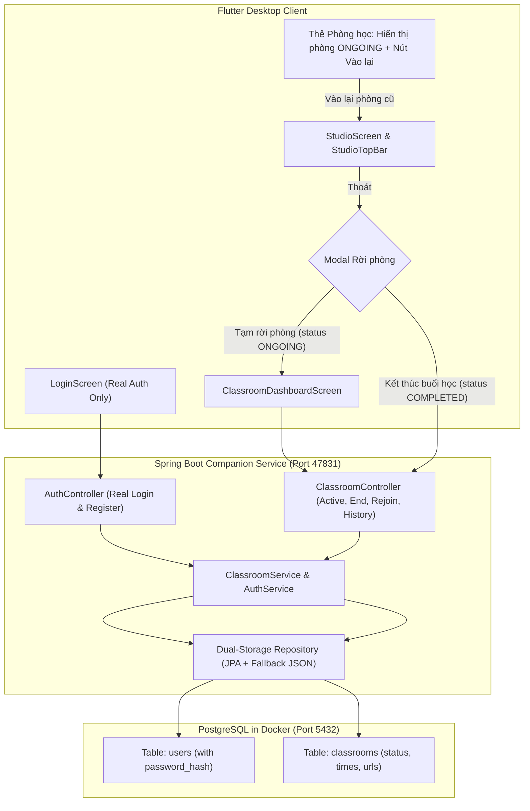

# Implementation Plan - Classroom Session Lifecycle, Real Auth & PostgreSQL Persistence

Quản lý vòng đời phòng học trực tuyến (Tạm rời phòng vs Kết thúc buổi học), Rejoin phòng đang diễn ra, loại bỏ Mock Account để chuyển sang Đăng nhập thật, hoàn thiện luồng Đăng xuất và lưu trữ dữ liệu bền vững vào PostgreSQL Docker.

---

## User Review Required

> [!IMPORTANT]
> **Loại bỏ hoàn toàn tài khoản Mock Demo Thầy Khắc Toàn:**
> Sau khi áp dụng, trên giao diện đăng nhập sẽ không còn nút *"Thử nhanh tài khoản Demo"*. Giáo viên sẽ đăng nhập bằng tài khoản thật (Email/SĐT + Mật khẩu đã đăng ký, hoặc Google Account thật qua WebView).

> [!IMPORTANT]
> **Docker PostgreSQL Dependency & Fallback:**
> Hệ thống sẽ lưu trữ người dùng và phòng học vào PostgreSQL (`hocluc_postgres` trên Docker, cổng 5432). Để đảm bảo ứng dụng Companion Desktop không bị sập nếu giáo viên chưa bật Docker Desktop, backend Spring Boot sẽ có cơ chế **Graceful Dual-Storage Fallback** (kết nối PostgreSQL trước, nếu mất kết nối sẽ lưu dự phòng vào Local JSON Cache và đồng bộ lại khi DB online).

---

## Proposed Changes



---

### Database & Docker

#### [MODIFY] backend/db/init.sql
- Cập nhật bảng `users`: Thêm cột `password_hash VARCHAR(255)`.
- Tạo bảng `classrooms`:
  ```sql
  CREATE TABLE IF NOT EXISTS classrooms (
      id VARCHAR(64) PRIMARY KEY,
      teacher_id VARCHAR(64) NOT NULL REFERENCES users(id),
      title VARCHAR(255) NOT NULL,
      meeting_url TEXT NOT NULL,
      status VARCHAR(32) NOT NULL DEFAULT 'ONGOING',
      started_at TIMESTAMP DEFAULT CURRENT_TIMESTAMP,
      ended_at TIMESTAMP NULL,
      duration_minutes INT DEFAULT 0,
      created_at TIMESTAMP DEFAULT CURRENT_TIMESTAMP,
      updated_at TIMESTAMP DEFAULT CURRENT_TIMESTAMP
  );
  CREATE INDEX IF NOT EXISTS idx_classrooms_teacher_status ON classrooms(teacher_id, status);
  ```

---

### Backend (Spring Boot Companion Service)

#### [MODIFY] backend/api/pom.xml
- Thêm `spring-boot-starter-data-jpa` (hoặc `spring-boot-starter-jdbc`) và `org.postgresql:postgresql`.
- Thêm BCrypt password encoder (`spring-security-crypto`).

#### [MODIFY] backend/api/src/main/resources/application.properties
- Cấu hình DataSource kết nối PostgreSQL:
  ```properties
  spring.datasource.url=jdbc:postgresql://localhost:5432/hocluc_dev
  spring.datasource.username=admin
  spring.datasource.password=admin
  spring.datasource.driver-class-name=org.postgresql.Driver
  spring.jpa.hibernate.ddl-auto=update
  ```

#### [MODIFY] AuthService.java & AuthController.java
- Xóa bỏ method `loginDemoAccount()`.
- Chuyển `login()` và `register()` sang truy vấn và lưu thực tế vào bảng `users` trong PostgreSQL với mật khẩu đã băm.

#### [MODIFY] ClassroomService.java & ClassroomController.java
- Cập nhật `createClassroom`: Tạo bản ghi mới trong bảng `classrooms` với `status = 'ONGOING'`.
- Bổ sung `getActiveClassroom(String teacherId)`: Trả về phòng `ONGOING` gần nhất của giáo viên.
- Bổ sung `endClassroom(String classroomId)`: Đổi `status = 'COMPLETED'`, cập nhật `ended_at` và tính `duration_minutes`.
- Bổ sung `getClassroomHistory(String teacherId)`: Lấy danh sách các phòng `COMPLETED`.
- Bỏ thao tác xóa file `classroom.json` khi chỉ tạm rời phòng.

---

### Frontend (Flutter Client)

#### [MODIFY] auth_form_card.dart
- Xóa bỏ nút và logic `_handleDemoQuickLogin()` ("Thử nhanh với tài khoản Demo Thầy Khắc Toàn").
- Giữ lại đầy đủ: Đăng nhập mật khẩu thật, Đăng ký xác thực OTP và Đăng nhập Google thật.

#### [MODIFY] google_meet_auth_service.dart & local_service.dart
- Dọn dẹp hàm `signInWithDemoTeacher` và `loginDemoAccount`.
- Cập nhật `signOut()` dọn dẹp triệt để `SharedPreferences` và các token phiên.

#### [MODIFY] studio_screen.dart & studio_top_bar.dart
- Nâng cấp Modal xác nhận khi bấm Thoát tại Studio:
  - Nút **"Tạm rời phòng"**: Thoát WebView Studio, giữ nguyên trạng thái `ONGOING` trên backend, điều hướng về `ClassroomDashboardScreen`.
  - Nút **"Kết thúc buổi học"**: Gọi API `/api/classroom/{id}/end`, đóng hẳn cuộc gọi Google Meet, chuyển trạng thái `COMPLETED` và điều hướng về Dashboard.

#### [MODIFY] classroom_dashboard_screen.dart
- **Quản lý trạng thái phòng học:**
  - Khi load Dashboard: Gọi API lấy active classroom.
  - Nếu có phòng `ONGOING`: Thẻ "Phòng học" hiển thị card thông tin phòng (Tên phòng, link Meet, thời gian đã bắt đầu) kèm nút **"Vào lại" (Rejoin)**.
  - Bấm "Vào lại" $\rightarrow$ Điều hướng vào Studio với link Meet cũ.
  - Bấm "Bắt đầu": Luôn tạo phòng mới 100% (nếu có phòng cũ đang chạy, hiện dialog xác nhận đóng phòng cũ).
- **Thẻ "Lịch sử":** Hiển thị danh sách các buổi học `COMPLETED` lấy từ API.
- **Đăng xuất:** Khi bấm Đăng xuất từ avatar menu, gọi `signOut()` và thực hiện `Navigator.pushAndRemoveUntil` văng ngay ra `LoginScreen`.

---

## Verification Plan

### Automated Tests
1. **Flutter Tests:**
   ```powershell
   flutter test
   ```
   Xác nhận toàn bộ widget tests và unit tests cho Auth, Dashboard, Lobby và Studio đều PASS.
2. **Backend API Tests:**
   Kiểm tra build Maven:
   ```powershell
   cd backend\api
   mvn clean test
   ```

### Manual Verification
1. **Kiểm tra đăng nhập:**
   - Mở app, xác nhận không còn nút Demo.
   - Đăng nhập tài khoản thật (hoặc tạo tài khoản mới bằng OTP).
2. **Kiểm tra luồng Tạm rời phòng & Rejoin:**
   - Bấm "Bắt đầu" $\rightarrow$ Tạo phòng Meet mới $\rightarrow$ Vào Studio.
   - Bấm Thoát ở Studio $\rightarrow$ Chọn **"Tạm rời phòng"**.
   - Trở lại Dashboard $\rightarrow$ Thẻ "Phòng học" hiển thị phòng với badge "Đang phát sóng" và nút **"Vào lại"**.
   - Bấm **"Vào lại"** $\rightarrow$ Trở lại Studio đúng link cũ.
3. **Kiểm tra luồng Kết thúc buổi học:**
   - Tại Studio, bấm Thoát $\rightarrow$ Chọn **"Kết thúc buổi học"**.
   - Trở lại Dashboard $\rightarrow$ Thẻ "Phòng học" trở về trạng thái trống; thẻ "Lịch sử" hiển thị buổi học vừa hoàn thành.
4. **Kiểm tra Đăng xuất:**
   - Bấm Avatar menu $\rightarrow$ Chọn **"Đăng xuất"**.
   - Ứng dụng lập tức đưa về màn hình `LoginScreen`.
