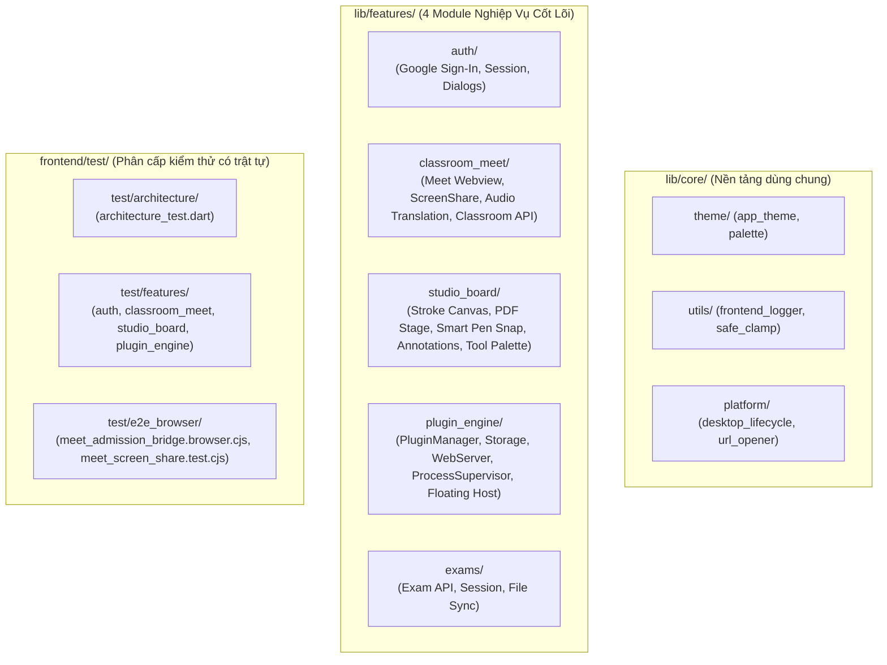

# Plan: Tái Cấu Trúc Frontend Clean Architecture & Xử Lý Trùng Lặp Plugin

**Date:** 2026-10-19  
**Mode:** --hard  
**Risk:** normal — Di chuyển cấu trúc file và cập nhật import đường dẫn trong Frontend; bảo toàn 100% logic với lưới an toàn 64 tests hiện hữu.  
**Spec Reference:** [plans/frontend-clean-architecture-and-plugin-cleanup/spec.md](file:///d:/Project/FptProject/HocLuc-TeacherStation-Flutter/plans/frontend-clean-architecture-and-plugin-cleanup/spec.md)  

---

## 1. Executive Summary & Architecture Blueprint

Tái cấu trúc toàn bộ mã nguồn `frontend/lib/` (48 services, 36 widgets) và `frontend/test/` (64 files phẳng) sang kiến trúc **Clean Architecture (Feature-First / Modular Monolith)**:

---

## 2. Phases Overview & Story Coverage

| Phase | Title | Scope & Output Files |
| :--- | :--- | :--- |
| **Phase 01** | Dead Code Cleanup & Directory Scaffolding | Xóa các file dead code (`sidecar_manager*.dart`), kiểm tra `pubspec.yaml`, thiết lập cây thư mục chuẩn `lib/core/` và `lib/features/{auth, classroom_meet, studio_board, plugin_engine, exams}`. |
| **Phase 02** | Core & Feature Modules Migration | Di chuyển 48 files từ `lib/services/` và 36 files từ `lib/widgets/` về đúng module tính năng tương ứng. Cập nhật 100% đường dẫn import, đảm bảo `flutter analyze` 0 issues và `flutter test` pass 100%. |
| **Phase 03** | Test Suite Restructuring & CJS Separation | Phân loại 64 file test phẳng sang `test/features/`, `test/architecture/`, chuyển 2 file script Node CJS sang `test/e2e_browser/`, cập nhật import và đảm bảo toàn bộ tests chạy mượt mà. |
| **Phase 04** | Architecture Invariants & CI Enforcement | Mở rộng `test/architecture/architecture_test.dart` với Bất biến 8 (cấm file trôi nổi `lib/widgets` và `lib/services`), Bất biến 9 (cấm file phẳng ở root `test/`), và Bất biến 10 (cấm dependency ma); cập nhật tài liệu `ARCHITECTURE.md` và `AGENTS.md`. |

---

## 3. Risks & Mitigations

1. **Rủi ro đứt gãy đường dẫn import (`import 'package:...';`)**:
   * *Nguyên nhân*: Di chuyển đồng loạt hàng chục file khiến import tương đối hoặc tuyệt đối bị lỗi.
   * *Giải pháp*: Tiến hành di chuyển theo từng module độc lập (Core -> PluginEngine -> Auth -> ClassroomMeet -> StudioBoard), chạy `flutter analyze` sau mỗi module để fix triệt để import.
2. **Rủi ro ảnh hưởng đến script kiểm tra CI hiện tại**:
   * *Nguyên nhân*: CI đang trỏ đường dẫn cứng `flutter test test/architecture_test.dart`.
   * *Giải pháp*: Giữ nguyên file chốt chặn tại `test/architecture_test.dart` hoặc cập nhật đường dẫn tương ứng trong `.github/workflows/ci-frontend.yml`.
3. **Rủi ro rò rỉ hành vi logic (Behavioral Regression)**:
   * *Nguyên nhân*: Vô tình sửa code trong quá trình format hoặc move.
   * *Giải pháp*: Tuyệt đối không thay đổi logic bên trong class/hàm; chỉ di chuyển file và sửa header import. 64 test files đóng vai trò bảo chứng 100%.
4. **Rủi ro gãy CI do đổi đường dẫn `architecture_test.dart` (Red-Team Finding)**:
   * *Nguyên nhân*: `.github/workflows/ci-frontend.yml` và các script đang gọi lệnh `flutter test test/architecture_test.dart`.
   * *Giải pháp*: Giữ nguyên file chốt chặn tại `frontend/test/architecture_test.dart` (làm file chốt duy nhất ở root `test/`), chỉ di chuyển các file test nghiệp vụ khác vào `test/features/`.

---

## 4. Verification Gate

- `flutter analyze --no-fatal-infos` -> 0 errors, 0 warnings.
- `flutter test` -> 100% test files pass.
- `node scripts/validate_plugins.mjs` -> 0 errors.
- Thư mục `lib/services/` và `lib/widgets/` không còn các file trôi nổi ngoài module.

---

## Phases Progress
- [x] Phase 01: Dead Code Cleanup & Directory Scaffolding
- [x] Phase 02: Core & Feature Modules Migration
- [x] Phase 03: Test Suite Restructuring & CJS Separation
- [x] Phase 04: Architecture Invariants & CI Enforcement

## Session Notes
<!-- Updated by cook automatically — do not edit manually -->

**Last active:** 2026-10-19 14:32
**Phase in progress:** Completed
**Status:** All 4 phases successfully completed with 0 errors. 10/10 architecture invariants passing; 392/392 unit/widget tests passing; 2/2 plugins verified.

### Decisions made this session
- Fully removed legacy `lib/services/` and `lib/widgets/` directories; all 85+ files migrated cleanly to `lib/features/<module>/` and `lib/core/`.
- Restructured all 64 test files into `test/features/` and `test/e2e_browser/`, keeping `test/architecture_test.dart` at the root as the sole guardian.
- Added Invariant 8 (no loose files in services/widgets), Invariant 9 (no flat tests at test root), and Invariant 10 (no ghost path dependencies in pubspec.yaml) to `architecture_test.dart`.
- Published `ARCHITECTURE.md` and updated `AGENTS.md` to permanently guide developers and AI coding agents.

### Next immediate action
- Final review and verification gate before PR creation.
