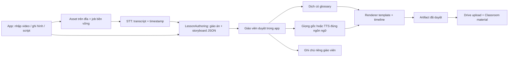

# Soạn bài với AI và xuất bản Classroom

> Kế hoạch sản phẩm hiện hành sau yêu cầu “plan lại”: [Phân hệ SOẠN BÀI trong app](../lesson-preparation-app/plan.md). Tài liệu này giữ làm tham khảo pipeline kỹ thuật; không triển khai như một roadmap cạnh tranh.

Mode: --hard
Risk: high-risk — thay đổi dữ liệu bài soạn, OAuth, quyền Drive/Classroom và đường xuất nội dung riêng tư.
Ngày: 2026-10-19. Trạng thái: đang triển khai; có pipeline local và video smoke thật, chưa hoàn tất nghiệm thu đầu cuối. Xem [trạng thái thực tế](../../docs/lesson-preparation.md). Đặc tả: [spec.md](spec.md).

## Phạm vi và quyết định

STT, dịch và TTS trở thành công cụ trong Soạn bài; không là điều kiện để mở lớp trực tiếp qua Meet/Classroom/Calendar. MVP theo lựa chọn người dùng: STT tiếng Việt → dịch Việt–Anh → narration tiếng Anh bằng model hiện có. Giữ giọng Việt gốc là tùy chọn; TTS tổng hợp tiếng Việt để giai đoạn sau. Ưu tiên video đơn giản gồm slide, chữ, sơ đồ, hình và chuyển động có giọng đọc. Cảnh/nhân vật sinh bằng AI là adapter mở rộng sau khi xác định nhà cung cấp, chi phí và quyền sử dụng.

Mặc định local-first; không gửi media/nội dung sang cloud nếu chưa có opt-in rõ ràng. Authoring local và template xác định không bị chặn bởi việc chưa chọn dịch vụ tạo cảnh. Không tự xóa runtime/live code hiện có trước khi luồng thay thế được nghiệm thu.

MVP gồm nhập video/ghi hình, bản chép lời có mốc nguồn, giáo án và storyboard có bước duyệt, video có giọng đọc, ghi chú riêng và đăng học liệu Classroom từ app. Không xây lại CRUD bài soạn, danh sách lớp hoặc OAuth đang có.

## Bằng chứng hiện tại

- [PlanningService](../../backend/api/src/main/java/vn/teaching/service/PlanningService.java) và [PlanningController](../../backend/api/src/main/java/vn/teaching/controller/PlanningController.java): đã có CRUD và clone-to-classroom. Clone tạo dữ liệu bài học nội bộ; không coi là Google Classroom publish.
- [LocalService](../../frontend/lib/core/network/local_service.dart): đầu mối tái sử dụng API bài soạn.
- [StudioSpeakerNotesBar](../../frontend/lib/features/studio_board/presentation/studio/studio_speaker_notes_bar.dart) và [studio_state_annotations](../../frontend/lib/features/studio_board/domain/models/studio_state_annotations.dart): đã có ghi chú theo trang, setter đánh dấu dirty và dữ liệu serialize; chưa đủ bằng chứng autosave. Overlay hiện chỉ có trên board; cần hoàn thiện quyền riêng tư và truy cập khi dạy.
- [Handout exporter](../../frontend/lib/features/studio_board/services/pdf_annotation_handout_exporter.dart) đang đưa pageNotes vào handout; phải tách bản giáo viên và bản học sinh trước upload. Nhãn WGC ready/private trong [settings](../../frontend/lib/features/studio_board/presentation/studio/studio_notes_settings_tab.dart) không thay thế bằng chứng capture; RepaintBoundary không phải stream chia sẻ Meet.
- [PresentationSurface](../../frontend/lib/features/studio_board/presentation/presentation_surface.dart): nền tảng output bài giảng; vị trí overlay riêng không chứng minh an toàn nếu chia sẻ toàn màn hình.
- [MeetScreenShareScript](../../frontend/lib/features/classroom_meet/services/meet_screen_share_script.dart): dùng trình chọn getDisplayMedia, theo dõi trạng thái chia sẻ; chưa có bằng chứng clean output được chia sẻ an toàn qua Meet.
- [models.py](../../backend/ai-runtime/models.py): PhoWhisper-small STT tiếng Việt, VinAI Việt→Anh, Kokoro tiếng Anh. Không suy ra TTS tiếng Việt, LLM soạn giáo án hay renderer video từ ba model hiện có. Endpoint ngắn hiện tại không phải pipeline video dài.

## Kiến trúc đích

Frontend mới theo `features/lesson_preparation/{presentation/screens,presentation/widgets,services,domain/models}`; chuyển đổi/tái sử dụng bài soạn cũ qua adapter. Backend tách orchestration job, asset storage, authoring adapter, speech adapter, renderer và Google publishing; không ghép LLM vào model dịch. Lưu file trên đĩa, metadata/revision trong kho dữ liệu hiện hữu sau khi xác minh cơ chế lưu. Worker chỉ tải model cần cho stage, tuần tự trên máy hạn chế VRAM; hủy phải kết thúc process và giải phóng tài nguyên.

Danh tính xuyên suốt: `planId → revisionId → sourceAssetId / jobId → artifactId → courseId / driveFileId / materialId`. Ghi chú/đáp án dùng dữ liệu riêng; artifact dành cho học sinh theo allowlist.

## Lộ trình và điểm nghiệm thu

| Giai đoạn | Đầu ra | Phụ thuộc | Story |
|---|---|---|---|
| [01](phase-01-foundation-privacy.md) | Schema bài soạn, migration, notes riêng và clean output | Không | P1 ghi chú riêng, nền dữ liệu |
| [02](phase-02-media-transcript.md) | Nhập/ghi media, STT dài có nguồn | 01 | P1 video thành bài |
| [03](phase-03-authoring-translation.md) | Giáo án/storyboard có duyệt, dịch có kiểm soát | 01–02 | P1 video/script/prompt |
| [04](phase-04-animation-narration.md) | Animation đơn giản, giọng đọc và MP4 | 03 | P1 animation ưu tiên |
| [05](phase-05-classroom-publishing.md) | Đăng học liệu và kiểm tra quyền học sinh | 01, 04 | P1 Classroom trong app |
| [06](phase-06-preparation-extensions.md) | Tiện ích mới, adapter cảnh sinh AI tùy chọn | 03–05 | P2/P3 mở rộng |

Các phase triển khai nối tiếp, không tự chạy cook từ tài liệu này. Trước khi bắt đầu chốt chất lượng/giới hạn video mục tiêu và môi trường tài khoản Google kiểm thử. Narration tiếng Anh là MVP đã chọn; không chặn vì chưa có TTS tiếng Việt. Không giả định đã có ngân sách dịch vụ tạo cảnh.

## Hợp đồng API dự kiến, chưa tồn tại theo kế hoạch này

- `POST /api/plannings/{planId}/sources`: đăng ký/upload media theo luồng, không đọc cả video vào RAM.
- `POST /api/plannings/{planId}/jobs`: tạo stage với `revisionId`, input artifact và cấu hình; trả `jobId`.
- `GET /api/preparation/jobs/{jobId}`; `POST .../{jobId}/cancel`; `POST .../{jobId}/retry`: trạng thái, tiến độ theo stage và lỗi có thể sửa.
- `POST /api/plannings/{planId}/revisions/{revisionId}/publish`: nhận `courseId`, danh sách artifact đã duyệt, visibility và khóa chống lặp; trả publication operation, không coi HTTP timeout là chưa đăng.

Job lưu `queued/running/succeeded/failed/cancelled`, stage checkpoint, phiên bản model/template và lỗi; kiểm tra revision tránh kết quả cũ ghi đè chỉnh sửa mới. Retry stage dùng artifact upstream hợp lệ, không chạy lại toàn bộ mặc định.

## Rủi ro và cổng bắt buộc

1. Ghi chú có thể lộ nếu giáo viên chọn toàn màn hình; chỉ nghiệm thu riêng tư sau khi thiết bị học sinh xác nhận clean output. Nếu chưa có đường capture sạch, không được gắn nhãn an toàn và không tự mở notes khi đang chia sẻ output không xác minh.
2. STT/dịch/TTS đánh giá riêng trên tập giữ lại với timestamp, WER và chất lượng ngữ nghĩa; loss không thay thế đánh giá nội dung. TTS tiếng Việt cần adapter được chứng minh hoặc giọng gốc.
3. Nội dung sinh AI phải duyệt trước khi render/publish; JSON schema giới hạn template, không chạy mã tùy ý do AI sinh. FFmpeg chạy bằng mảng đối số, worker hạn mức tài nguyên.
4. Publish dùng Drive resumable upload, scope tối thiểu, journal/reconciliation để tránh tài liệu trùng khi timeout; không retry create mù. Xác minh bằng tài khoản học sinh thực.
5. Mọi thao tác nghiệp vụ ở app; lần cấp quyền OAuth có thể phải mở trình duyệt hệ thống theo chính sách Google. Không hứa đăng nhập nhúng hoặc hoàn toàn không có màn hình Google bên ngoài.

## Xác minh và bàn giao

Đây là kế hoạch, chưa có chứng cứ chạy model, render hay publish mới. Khi triển khai mỗi phase phải lưu lệnh, kết quả, giới hạn máy và case thất bại. Gate toàn repo: `node scripts/validate_plugins.mjs`; trong `frontend`: `flutter test test/architecture_test.dart`, `flutter analyze --no-fatal-infos`; build web release khi thay đổi frontend dùng đa nền tảng. Bật hooks bằng `node scripts/setup_hooks.mjs` trước commit. Plugin thay đổi phải đóng gói theo schema v2.1; không thêm plugin ID vào core. Chỉ commit nguồn và đúng phạm vi, không weights, media mẫu riêng tư, OAuth credentials hoặc render tạm.

Nguồn Google chính thức: [Classroom material create](https://developers.google.com/workspace/classroom/reference/rest/v1/courses.courseWorkMaterials/create), [Drive uploads](https://developers.google.com/workspace/drive/api/guides/manage-uploads), [OAuth native app](https://developers.google.com/identity/protocols/oauth2/native-app).
