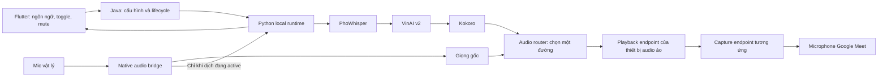

# Plan: Tích hợp ba model AI để dịch lời giảng Việt → Anh

Ngày lập: 13/10/2026. Độ phức tạp: cao. Baseline source: `36901c8` trên `feat/vact-hsa-exam-platform`. Người dùng đã confirm triển khai; code/runtime pilot đã được xây dựng trên `feat/local-ai-speech-translation`. Kết quả và các gate còn thiếu được ghi tại `docs/ai-speech-acceptance.md`; driver/Meet vẫn cần acceptance thực tế. Installer tự tải model là phạm vi tiếp theo.

## 1. Phạm vi đã chốt

Giữ dropdown **Ngôn ngữ đầu ra** và thêm toggle **Phát bản dịch tiếng Anh**. Giáo viên đã xác nhận cách điều khiển này trong chat. Một ngôn ngữ đầu ra chung cho học sinh trong phiên Meet; đầu vào pilot là giọng giáo viên tiếng Việt.

- Mặc định mỗi phiên mới: toggle OFF, phát giọng gốc.
- Chọn `English` chỉ chọn ngôn ngữ mong muốn; không tự bật dịch.
- Giáo viên bật toggle khi `English` được chọn để yêu cầu dịch và phát giọng Anh.
- Chọn lại `Tiếng Việt (giọng gốc)` khi đang dịch sẽ tắt toggle, hủy audio dịch và chuyển về đường giọng gốc.
- Có thể nhớ ngôn ngữ, mic và giọng đọc đã chọn; không nhớ trạng thái bật dịch qua lần mở app/lớp mới hoặc reconnect sau khi runtime lỗi.
- Mute áp dụng cho cả giọng gốc và giọng dịch. Unmute không phát lại lời đã nói trong thời gian mute.
- Bản đầu không trộn đồng thời tiếng Việt và tiếng Anh vào Meet. Giáo viên có thể nghe thử bằng tai nghe qua một đầu ra monitor riêng.
- Dùng ba model hiện có để inference trước; fine-tune chỉ là công việc sau khi có đánh giá lỗi thực tế.

Pilot thực hiện trên bản Flutter Windows native đang dùng (`frontend/build/windows/x64/runner/Release/teaching_companion.exe`). Interface audio và model adapter tách riêng để bổ sung macOS/CoreAudio sau; không gọi macOS hoặc Flutter Web là đã hỗ trợ đầy đủ trước khi có adapter và kiểm thử tương ứng. Gói portable của `Build-Windows.ps1` hiện là Flutter web trong WinForms/WebView2, không phải cùng binary native: gói đó cần audio helper/IPC riêng nếu muốn hỗ trợ sau pilot.

## 2. Hiện trạng đã kiểm tra

Bảng này ghi snapshot trước triển khai. Trạng thái hiện tại và bằng chứng sau thay đổi nằm trong báo cáo acceptance.

| Thành phần | Bằng chứng source/local | Hệ quả |
|---|---|---|
| Flutter settings | `frontend/lib/widgets/studio/studio_notes_settings_tab.dart` có dropdown ngôn ngữ, mic, endpoint và denoise | Tái sử dụng panel hiện có |
| Studio state | `frontend/lib/models/studio_state.dart`: field mặc định tiếng Việt, nhưng `initialize()` fallback `English`; `save()` lưu language/endpoint/mic/denoise | Chuẩn hóa fallback và migration; cấu hình cũ không được tự bật AI |
| Native microphone | `frontend/lib/services/teacher_media_service_native.dart` chỉ thay đổi bool và mức audio cố định bằng 0 | Cần capture/mute thật; trạng thái UI không chứng minh mic đã tắt |
| Web microphone | `teacher_media_service_web.dart` đã dùng MediaStream cho preview và mute track | Có thể tái sử dụng preview; chưa chứng minh audio đã tới Meet |
| Device API | `backend/api/src/main/java/vn/teaching/service/DeviceService.java` chỉ liệt kê JavaSound; capture, AI streaming, mic ảo vẫn false | Báo readiness từ adapter thật, không từ nhãn UI |
| Native video | Có `frontend/plugins/wgc_broadcaster` | Video và audio cần đường riêng; không dùng video bridge làm bằng chứng mic ảo |
| Portable launcher | `Build-Windows.ps1`, `packaging/windows/Program.cs` dùng WebView2/Flutter web | Plugin Flutter Windows không tự chạy trong gói này; đóng gói native cho pilot, bridge helper portable là gate riêng |
| Model assets | Có ba thư mục dưới `D:/AI-Training/models` | Asset hiện diện chưa chứng minh tokenizer/dependency/inference hoạt động |
| Máy pilot | Phiên này đã xác nhận GTX 1650 4 GB VRAM, khoảng 7.4 GiB RAM | Phải đo tải kết hợp Flutter + Java + browser + model |

Không sửa các thư mục cũ `app/`, `service/`, các dataset hoặc environment Unsloth để triển khai runtime mới.

## 3. Vai trò và adapter model

| Model/path local | Nhiệm vụ | Runtime baseline và lưu ý |
|---|---|---|
| `D:/AI-Training/models/PhoWhisper-small` | Audio Việt → transcript Việt | Transformers baseline, mono 16 kHz, task transcribe; không dùng chế độ translate thay model dịch |
| `D:/AI-Training/models/vinai-translate-vi2en-v2` | Transcript Việt → bản dịch Anh | Transformers seq2seq/MBART; kiểm tra tokenizer, source/target language IDs của checkpoint, số và thuật ngữ; không đưa prompt chatbot vào model này |
| `D:/AI-Training/models/Kokoro-82M` | Bản dịch Anh → audio Anh | Nạp config + `kokoro-v1_0.pth` + voice `.pt` local; chọn voice English đã kiểm thử; đầu ra 24 kHz theo workflow tác giả |

Kokoro phục vụ giọng đọc có sẵn. Plan không hứa giữ giọng riêng của giáo viên; voice cloning/conversion là phạm vi khác. Bộ ba hiện tại chỉ mở luồng dịch Việt → Anh. Các lựa chọn Nhật/Hàn/Pháp trong dropdown được đánh dấu chưa hỗ trợ và không kích hoạt pipeline.

Cấu hình benchmark đầu tiên: ưu tiên PhoWhisper GPU nếu vừa bộ nhớ, VinAI và Kokoro CPU. Đây là giả thuyết để đo, không phải cấu hình đã đạt realtime. Chạy từng model trước, rồi thử tải kết hợp. Có CPU fallback khi phù hợp; không tự báo trạng thái dịch sẵn sàng nếu fallback không đạt khả năng xử lý liên tục.

Nếu chưa đạt: thử export đúng checkpoint PhoWhisper sang CTranslate2/faster-whisper và VinAI sang CTranslate2 INT8, với kiểm thử tương đương trước/sau. MBART và Whisper thuộc nhóm kiến trúc CT2 hỗ trợ, nhưng bản export cụ thể vẫn phải kiểm chứng. Không nạp trực tiếp thư mục Transformers `.bin` vào faster-whisper như một model CT2. Không thay PhoWhisper bằng Whisper Small gốc mà vẫn dùng tên PhoWhisper trong UI/report. Pin phiên bản và kiểm tra CUDA/cuDNN; không áp dụng BF16 hoặc FP16 theo giả định.

## 4. Trạng thái và quy tắc bật/tắt

Tách ba khái niệm: `targetLanguage` là lựa chọn đã lưu, `translationRequested` là ý định trong phiên, `effectiveMode` là đường audio đang phát thật. Toggle và nhãn hoạt động phải theo kết quả runtime, không chỉ bool được đổi ở UI.

| Lựa chọn / hành động | Trạng thái phát thật | Hành vi |
|---|---|---|
| App/lớp mới, kể cả config đã lưu English | `ORIGINAL` nếu audio bridge sẵn sàng | Toggle OFF; không nạp model hoặc thu cho AI chỉ vì mở lớp |
| English + toggle OFF | `ORIGINAL` | Học sinh nghe giọng gốc |
| English + yêu cầu ON | `PREPARING` | Chuẩn bị model và kiểm tra output; hiển thị rõ giọng gốc còn đang phát |
| Model/output sẵn sàng và yêu cầu ON còn hợp lệ | `ENGLISH` | Chuyển đường audio nguyên tử; chỉ phát bản dịch sau thời điểm kích hoạt |
| Tiếng Việt + yêu cầu ON | Không hợp lệ | UI vô hiệu hóa toggle; backend cũng từ chối |
| Tắt toggle hoặc chọn Tiếng Việt | `ORIGINAL` | Hủy generation cũ, xóa queue, ngắt TTS đang phát rồi trả giọng gốc |
| Mute | `MUTED` | Ngắt cả capture dùng cho AI và hai đường phát; xóa queue, không phát bù khi unmute |
| Runtime lỗi/quá tải khi đang dịch | `ERROR_ORIGINAL` nếu đường gốc vẫn khỏe | Toggle OFF, hủy queue, báo đã quay về giọng gốc; giáo viên phải chủ động bật lại |
| Mất mic hoặc mất output | `UNAVAILABLE` | Im lặng trên đường bị mất và báo thiết bị; không báo giọng gốc vẫn phát nếu không phát được |
| Rời lớp/đóng app | `STOPPED` | Dừng capture, playback, socket và phiên AI |

`ORIGINAL` là tên mode, không có nghĩa đã sẵn sàng: cần `captureReady` và `outputReady` riêng. Đang PREPARING có thể hủy bằng toggle; kết quả warm-up đến muộn không được bật lại. Runtime phục hồi không tự tái bật dịch.

Giữ dropdown, mic picker và toggle trong panel settings hiện tại. Có nút nghe thử giọng trước khi phát vào Meet và nhãn ngắn: **Giọng gốc / Đang chuẩn bị / Đang dịch sang Anh / Đã tắt mic / Chưa sẵn sàng**. Thông số model, port và device code đặt trong cấu hình kỹ thuật, không đưa vào luồng dạy chính.

## 5. Kiến trúc đề xuất



- **Flutter:** state, điều khiển phiên, phụ đề giáo viên và thao tác thiết bị; không chạy inference trên UI isolate.
- **Java:** quản lý config, cấp session/generation ID, khởi động Python theo nhu cầu, health và dừng child process. Tái sử dụng lifecycle sidecar hiện có; không khởi động model chỉ để hiển thị dashboard.
- **Python:** một process inference chính, adapter ASR/MT/TTS, VAD/chốt đoạn, queue và metrics. Dùng venv riêng ở `backend/ai-runtime/.venv`; không dùng environment Unsloth. Không nhiều worker cùng nạp lại ba model.
- **Native audio bridge mới:** WASAPI capture/render trên Windows, chọn thiết bị bằng ID ổn định, resample, mute, routing và playback trên worker thread. Interface platform riêng cho macOS sau này.
- **Truyền audio:** PCM nhị phân qua WebSocket local giữa bridge và Python, không gửi frame liên tục qua REST JSON của `/api/config`. Flutter/Java dùng REST/event stream cho lệnh và trạng thái.
- **Thiết bị ảo:** pilot dùng một thiết bị virtual audio đã cài/được lựa chọn và kiểm chứng tương thích. WASAPI đọc/ghi endpoint, không tự tạo driver mic ảo. Không viết driver kernel trong vòng đầu. Trước demo Meet phải xác định đúng cặp playback/capture, cách cài và quyền phân phối của component được chọn.

Giọng gốc và giọng dịch đi qua cùng một thiết bị ảo để giáo viên không đổi mic trong Meet mỗi lần gạt toggle. Meet phải chọn capture endpoint đó, không chọn trực tiếp mic vật lý. Monitor tai nghe là đường riêng; không thu system loopback/âm thanh học sinh làm đầu vào ASR.

## 6. Config và hợp đồng phiên

Config version 2 đề xuất chỉ lưu lựa chọn:

```json
{
  "audio": {
    "schemaVersion": 2,
    "targetLanguage": "vi",
    "inputDeviceId": "",
    "outputDeviceId": "",
    "voiceId": "af_heart",
    "denoiseRequested": false
  }
}
```

`translationRequested`, mute, active session và generation ID không lưu vào config. Chuẩn hóa field `language` cũ từ English/Tiếng Việt sang en/vi; thiếu/không hợp lệ → vi. Config cũ English vẫn được giữ là lựa chọn nhưng toggle OFF. Endpoint remote cũ không tự trở thành server nhận audio: runtime local là provider mặc định của pilot.

Contracts dự kiến dưới `backend/ai-runtime/contracts/`: sessionId, generationId, segmentId, frame sequence, timestamp, format, source language, target language. Capture gốc theo format endpoint; resample mono 16 kHz cho ASR. TTS 24 kHz được đổi sang format playback endpoint trước khi phát, không giả định mọi thiết bị là 48 kHz.

Routes mới dự kiến dưới `/api/audio`: `GET capabilities`, `GET status`, `POST sessions`, `PUT sessions/{id}/mode`, `PUT sessions/{id}/mute`, `DELETE sessions/{id}` và luồng events. File WAV test có endpoint riêng, giới hạn dung lượng/thời gian. `/api/config` chỉ lưu lựa chọn; lưu config không được kích hoạt phiên.

Java/Python bind loopback, socket dùng token nội bộ ngắn hạn theo session và kiểm tra Origin/format/sequence. Model paths lấy từ cấu hình kỹ thuật whitelist, không nhận đường dẫn tùy ý từ UI. Không ghi audio/transcript bài giảng vào log hoặc lưu file mặc định; benchmark dùng fixture đã chọn riêng.

## 7. Sprint và task có thể commit

Các đường dẫn bên dưới là đề xuất cho file mới; chưa tồn tại nếu chưa triển khai. Mỗi sprint có demo độc lập, kiểm thử đúng lớp và không mở gate Meet bằng kết quả nghe local.

### Sprint 0 — Kiểm chứng model và hợp đồng dữ liệu

Demo: một file WAV tiếng Việt cố định → transcript → bản dịch → WAV giọng Anh, có báo cáo thời gian/bộ nhớ từng model. Chưa cần Flutter hoặc thiết bị ảo.

| Task | Vị trí | Phụ thuộc | Đầu ra / kiểm chứng |
|---|---|---|---|
| 0.1 Asset preflight | `backend/ai-runtime/scripts/preflight.py`, `config/models.example.json` | Không | Kiểm tra file weights, tokenizer/processor, voices và local load; thiếu asset báo rõ, không âm thầm tải checkpoint khác |
| 0.2 Môi trường và adapter baseline | `backend/ai-runtime/requirements.lock`, `adapters/{asr,translation,tts}.py`, `scripts/baseline.py` | 0.1 | Venv riêng, pin dependencies sau smoke test; input chuẩn của từng khối cho output đúng; lưu peak RAM/VRAM và thời gian |
| 0.3 Contracts và fixtures | `backend/ai-runtime/contracts/`, `tests/fixtures/`, `docs/ai-speech-baseline.md` | 0.1–0.2 | Schema PCM/text/events; bộ câu số, đơn vị, phủ định, thuật ngữ và im lặng; phiên bản/hash model và dữ liệu đánh giá |

Gate: từng model chạy được và có baseline chất lượng. Chưa đạt gate thì sửa dependency/asset, chưa nối vào app và chưa train thêm.

### Sprint 1 — Dropdown + toggle, mặc định không dịch

Demo: UI với fake audio service chứng minh chọn English không tự bật; bảng trạng thái hoạt động ở mobile/desktop mà chưa thu/phát audio thật.

| Task | Vị trí | Phụ thuộc | Đầu ra / kiểm chứng |
|---|---|---|---|
| 1.1 Model state và config migration | `frontend/lib/models/audio_translation_state.dart`, `studio_state.dart`, backend `LessonController.java` | 0.3 | Legacy config/missing fields/new class luôn OFF; không lưu active state; unit tests cho state transitions và migration |
| 1.2 Settings controls và trạng thái thật | `studio_notes_settings_tab.dart`, widget `audio_translation_controls.dart` mới | 1.1 | Dropdown giữ lại, toggle chỉ bật được với English; ngôn ngữ chưa hỗ trợ disabled; widget tests trên 375/768/1440 px |
| 1.3 Control service và mute integration | `frontend/lib/services/audio_translation_service.dart`, `teacher_media_service_native.dart`, tests audio mới | 1.1–1.2 | Interface start/mode/mute/stop; fake backend chậm/lỗi không khiến UI báo active; late callbacks bị bỏ sau OFF/mute/leave |

Gate: giáo viên luôn nhìn thấy requested/effective trạng thái rõ; không đổi nhãn cứng thành bằng chứng capture/denoise đã chạy.

### Sprint 2 — Audio bridge thật và đường giọng gốc

Demo: chọn mic vật lý, phát giọng gốc ra thiết bị đã chọn, mute thật; Python/model vẫn có thể chưa chạy.

| Task | Vị trí | Phụ thuộc | Đầu ra / kiểm chứng |
|---|---|---|---|
| 2.1 Native capture/device adapter | `frontend/plugins/audio_bridge/{lib,windows}/`, `frontend/pubspec.yaml` | 0.3, 1.3 | WASAPI IDs, capture/render format, worker thread; phát tone/thu file fixture đúng sample count; kiểm tra mic thật riêng |
| 2.2 Router bypass/mute/monitor | `audio_bridge/windows/audio_router.*`, native teacher media service | 2.1 | Một đường phát active, mute xóa buffer, không thu lại TTS; test route switch bằng marker audio và thử tai nghe |
| 2.3 Capabilities/device health | backend `DeviceService.java`, controller `AudioController.java` mới, Flutter audio service | 2.1–2.2 | Thay device ID JavaSound cho audio runtime bằng IDs native tương ứng; unplug/permission/output lỗi hiện đúng; UI không tự chọn nhầm mic mới |

Gate: raw route đáng tin cậy và mute được chứng minh. Denoise chỉ bật khi có adapter đã kiểm thử; ba model trên không cung cấp chức năng lọc nhiễu. Nếu giữ switch denoise cũ, báo chưa sẵn sàng thay vì nhãn xanh mặc định.

### Sprint 3 — Runtime local và phiên xử lý file

Demo: Flutter gửi một WAV test qua Java/runtime rồi nghe giọng Anh trong monitor, thấy transcript và metrics. Chưa tuyên bố học sinh nghe được qua Meet.

| Task | Vị trí | Phụ thuộc | Đầu ra / kiểm chứng |
|---|---|---|---|
| 3.1 Python runtime/lifecycle | `backend/ai-runtime/app/main.py`, backend `AudioRuntimeService.java`, `scripts/Start-AiRuntime.ps1` | Sprint 0 | Health, model load theo nhu cầu, dependency failure, process watcher; mở app không nạp model, đóng parent không để worker mồ côi |
| 3.2 Offline orchestration | `backend/ai-runtime/pipeline.py`, audio controller, Flutter audio service | 3.1, 0.3 | ASR → MT → TTS với cùng segment ID; golden input + timeout/cancel/model failure; giữ input chuẩn để đánh giá lỗi từng model |
| 3.3 Memory/performance profile | `scripts/benchmark.py`, config model/runtime | 3.2 | Báo tải kết hợp thực; thử CPU/GPU và CT2 nếu cần; so output trước/sau export, không dùng con số benchmark bên ngoài làm kết quả máy pilot |

Gate: pipeline offline đúng chức năng, vừa tài nguyên; nếu CPU không theo kịp phải đổi cấu hình/địa điểm inference trước khi gọi là realtime.

### Sprint 4 — Streaming mic và chuyển chế độ an toàn

Demo: giáo viên nói mic thật; OFF nghe giọng gốc, ON nghe tiếng Anh ở monitor; gạt OFF/mute không còn câu Anh từ phiên cũ.

| Task | Vị trí | Phụ thuộc | Đầu ra / kiểm chứng |
|---|---|---|---|
| 4.1 Audio socket + VAD | `backend/ai-runtime/streaming/{session,vad,segmenter}.py`, native bridge transport | Sprint 2–3 | PCM binary + metadata; chốt câu khoảng 2–6 s, giới hạn đoạn nói quá dài, loại silence, tránh chốt trùng ở overlap; fixture + mic thật |
| 4.2 Queue và generation cancellation | `streaming/queues.py`, `audio_router.*`, state/control services | 4.1 | Ordered segments; queue giới hạn; OFF/mute/account/session change xóa audio đang phát/chờ và bỏ callback muộn; test delayed ASR/MT/TTS |
| 4.3 Recovery và telemetry | runtime metrics, Java status events, Flutter controls | 4.1–4.2 | Vượt backlog không tiếp tục tích lũy hoặc âm thầm bỏ lời giảng; dừng dịch, trở về raw khi raw còn khỏe, yêu cầu bật lại; thử kill runtime/unplug mic/rapid toggle |

Ngưỡng pilot ban đầu: tối đa 3 segment chờ và tối đa 8 s audio output backlog, đo và điều chỉnh theo thử tải. Nếu vượt ngưỡng kéo dài, chuyển lỗi có thông báo; không tăng tốc TTS vô hạn hoặc tự bỏ câu. Giới hạn audio cần dựa cả số mẫu/thời lượng, không chỉ số phần tử queue.

Gate: 20–30 phút không phát trùng, không tăng dần queue; UI vẫn vẽ bảng mượt trong lúc inference. Reset VAD/context tại mỗi generation, không dịch lại audio đã nói khi OFF.

### Sprint 5 — Học sinh nghe qua Meet và đóng gói

Demo: hai thiết bị/tài khoản Meet; người tham gia thứ hai xác nhận OFF là giọng gốc, ON là tiếng Anh, mute im lặng, OFF giữa TTS không còn câu dịch cũ.

| Task | Vị trí | Phụ thuộc | Đầu ra / kiểm chứng |
|---|---|---|---|
| 5.1 Virtual audio transport acceptance | `audio_bridge`, `docs/ai-speech-setup.md` mới, Meet setup UI hiện có | 2.2, Sprint 4 | Chốt component/cặp endpoint; Meet chọn capture endpoint; test round-trip bằng participant khác và ghi nhận thiết bị/cấu hình thực |
| 5.2 Startup/packaging/cleanup | `Start.ps1` mode Windows, `scripts/Package-AiNativeWindows.ps1` mới, `frontend/lib/services/sidecar_manager_native.dart` | 3.1, 5.1 | Đóng gói Flutter Windows native + Java + Python runtime/version manifest; model paths cấu hình được, kiểm tra thiếu driver/asset; stop/restart/forced app exit không để process/socket giữ mic |
| 5.3 Acceptance report và rollback | `docs/ai-speech-acceptance.md`, scoped test suites | Các task trước | Báo P50/P95, chất lượng và giới hạn; rollback về giọng gốc; disable capability trên platform chưa kiểm chứng |

Gate: có bằng chứng người học nghe qua Meet thật, cùng số đo end-to-end. Không đánh dấu hỗ trợ đầy đủ chỉ bằng file WAV, widget tests hoặc speaker local.

Nếu mở rộng sang portable WebView2 sau pilot: tách WASAPI core thành audio helper executable, expose control/PCM qua IPC local được kiểm tra session, và nối lifecycle vào `packaging/windows/Program.cs`/`Build-Windows.ps1`. Phải kiểm thử lại mic permissions, routing, parent cleanup và Meet trên chính gói đó; không dùng kết quả native để đánh dấu portable đã đạt.

## 8. Tiêu chí chấp nhận chung

1. Toggle mặc định OFF ở phiên mới; chọn English/lưu config/reconnect không tự bật dịch. Server kiểm tra ngôn ngữ và readiness độc lập UI.
2. Tắt/mute/rời lớp hủy pending work ngay, bỏ kết quả cũ; chỉ phát câu bắt đầu trong generation đang active. Mục tiêu local stop-to-silence ≤150 ms, đo riêng thời gian buffer/network của Meet; không gọi 150 ms là latency dịch.
3. Với câu pilot 2–6 s, mục tiêu P95 từ chốt đoạn → âm tiếng Anh đầu tiên ở playback endpoint ≤3 s trên cấu hình được chọn. Báo thêm start-of-speech → first audio và phần người học nhận qua Meet; đây là gate đo, chưa là cam kết máy GTX 1650 đạt.
4. Giữ đúng số, đơn vị, phủ định và thuật ngữ trong bộ câu chưa dùng để chỉnh model; báo lỗi ASR, dịch và TTS riêng. TTS không thêm lời giảng; im lặng không phát nội dung bịa.
5. Không tăng dần backlog trong 20–30 phút; không làm freeze Flutter/Meet. Báo peak RAM/VRAM, startup/warm-up riêng với thời gian ổn định.
6. Các ca bắt buộc: English đã lưu khi mở app; rapid ON/OFF; OFF trong warm-up/TTS; mute/unmute; chọn vi khi active; thiết bị ngắt; Python crash; thiếu model/voice/tokenizer; socket timeout; đổi lớp; app bị đóng cưỡng bức.

## 9. Rủi ro, giới hạn và rollback

- VAD dựa khoảng nghỉ có thể cắt lời giảng dài: giới hạn đoạn, context ngắn theo session, kiểm thử nói tự nhiên và câu sửa lại; không dịch mọi partial transcript thành audio ngay.
- Máy thiếu bộ nhớ hoặc inference chậm: lượng tử hóa/export có kiểm chứng; giữ adapter để có thể dùng máy local mạnh hơn hoặc server do người dùng chủ động chọn sau. Không tự gửi audio lên cloud.
- Khi AI lỗi: raw fallback chỉ khi input/output còn hoạt động; UI ghi đúng mode. Nếu thiết bị mất, báo unavailable thay vì tuyên bố đã trở về raw.
- Noise suppression và echo cancellation là thành phần khác: chưa có adapter thì không quảng cáo đã lọc. Không thêm training/RVC để giải quyết vấn đề routing.
- Virtual device cần component/driver riêng và acceptance thật; cài đặt không nằm trong việc lập plan này. Kiểm tra điều kiện phân phối trước khi đóng gói component đó. VinAI model card ghi AGPL-3.0; lưu thông tin license/provenance trong manifest để đối chiếu khi phát hành, không suy ra quyền phân phối từ việc tải được file.
- Rollback: OFF, tăng generation, đóng socket AI và xóa playback buffer; giữ raw route nếu còn khỏe. Giữ checkpoint gốc, export version riêng và model manifest trước; không thay thế dữ liệu training hoặc xóa bản gốc.

## 10. Branch và commit khi triển khai

Branch riêng `feat/local-ai-speech-translation` bắt đầu từ `36901c8`. Phần pilot được chia commit theo runtime AI, native audio bridge, tích hợp điều khiển, đóng gói Windows và tài liệu.

Nhóm commit dự kiến: `build(ai): add isolated runtime and model preflight`; `feat(audio): add explicit translation controls and config migration`; `feat(audio): add native capture routing and mute`; `feat(ai): add local ASR translation and speech adapters`; `feat(audio): stream translated speech with bounded queues`; `fix(audio): cancel stale speech and recover to original mode`; `feat(audio): route classroom speech through virtual audio`; `docs(audio): document setup benchmarks and acceptance`.

## 11. Nguồn chính thức đã đối chiếu

Các nguồn dưới đây xác định capability/cách chạy, không phải benchmark đã chạy trên máy pilot. Session không có Context7 callable nên đối chiếu trực tiếp tài liệu chính thức.

- [PhoWhisper-small](https://huggingface.co/vinai/PhoWhisper-small): ASR tiếng Việt.
- [VinAI Translate v2](https://huggingface.co/vinai/vinai-translate-vi2en-v2) và [source tác giả](https://github.com/VinAIResearch/VinAI_Translate): dịch văn bản và tokenizer/ngôn ngữ.
- [Kokoro-82M](https://huggingface.co/hexgrad/Kokoro-82M) và [voices](https://huggingface.co/hexgrad/Kokoro-82M/blob/main/VOICES.md): TTS và voice English, workflow audio 24 kHz.
- [faster-whisper](https://github.com/SYSTRAN/faster-whisper): inference/export Whisper và dependency CUDA/cuDNN.
- [CTranslate2 Transformers guide](https://opennmt.net/CTranslate2/guides/transformers.html): hỗ trợ MBART/Whisper và converter.
- [Microsoft WASAPI](https://learn.microsoft.com/en-us/windows/win32/coreaudio/wasapi): capture/render endpoint trên Windows.

Tài liệu nội bộ liên quan: `docs/ai-training/three-ai-training-plan.md` là plan training cũ có đường dẫn trước restructure; kế hoạch tích hợp này dùng `frontend/` và `backend/` hiện tại.
