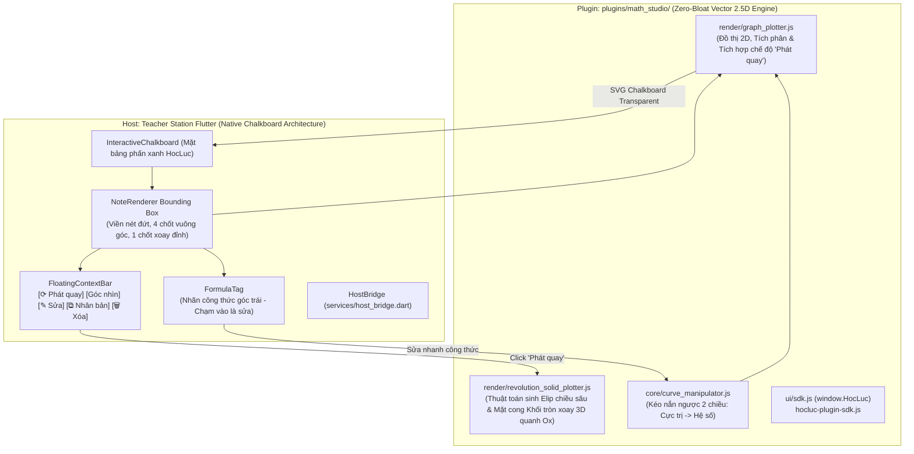

# Plan: Math Studio 2.0 (NoteRenderer UI/UX & Khối Tròn Xoay 2.5D Siêu Nhẹ)

**Date:** 2026-10-25  
**Mode:** Hard  
**Risk:** normal — nâng cấp toàn diện UI/UX bảng phấn theo phong cách NoteRenderer, bổ sung động cơ sinh khối tròn xoay 2.5D không phụ thuộc thư viện nặng, giữ vững 100% các bất biến kiến trúc Rule 1-3 của AGENTS.md  
**Domain Focus:** Nền tảng Toán học Trực quan Bản xứ (Native Chalkboard Math) — Bounding Box NoteRenderer, Floating Context Bar, Thuật toán "Phát quay" Khối tròn xoay 3D Giải tích 12, Kéo nắn đồ thị 2 chiều  
**Spec:** [plans/math-studio-plugin/spec.md](spec.md)  
**Report:** [plans/reports/261025-noterenderer-math-studio-refactor-brainstorm.md](../reports/261025-noterenderer-math-studio-refactor-brainstorm.md)

---

## Architecture & Technical Flow

---

## Phase Breakdown

- [x] **[Phase 1: Thuật toán Khối tròn xoay 2.5D Siêu nhẹ ("Phát quay" quanh Ox)](phase-01-revolution-solid-engine.md)**
  - *Covers:* P1-US04, FR-04, NFR-01.
  - Xây dựng mô-đun `plugins/math_studio/ui/render/revolution_solid_plotter.js` (thuật toán chiếu trục đo sinh đường elip đồng mức và mặt cong đối xứng).
  - Tích hợp cờ `isRevolved` vào `graph_plotter.js` và nút `⟳ 3D` trên thanh zoom control của plugin.
  - Kiểm thử `scripts/test_revolution_solid.mjs` đạt tốc độ 2.28ms, 3/3 tests PASS.

- [x] **[Phase 2: NoteRenderer Bounding Box & Floating Context Bar trên Bảng Phấn](phase-02-noterenderer-chalkboard-ui.md)**
  - *Covers:* P1-US01, P1-US02, P1-US03, FR-01, FR-02, FR-03.
  - Nâng cấp `BoardStickerCard` với viền nét đứt màu cam ấm `#D97706`, 4 chốt góc vuông và 1 chốt cuống xoay đỉnh.
  - Xây dựng thanh Floating Context Bar lơ lửng trên đỉnh gồm 5 nút: `[ ⟳ Phát quay ]`, `[ Sách GK ]`, `[ ✎ Sửa ]`, `[ ⧉ Nhân bản ]`, `[ 🗑 Xóa ]`.
  - Nền trong suốt 100%, hòa trọn vẹn vào caro và chất liệu bảng phấn xanh.

- [x] **[Phase 3: Tương tác 2 Chiều: Phát quay tức thì, Nhân bản & Sửa nhanh Công thức](phase-03-interactive-actions-and-formula-tag.md)**
  - *Covers:* P1-US05, P1-US06, P2-US07, P2-US08, FR-05, FR-06.
  - Tích hợp `duplicateSticker` trên `CanvasDrawingController` và `StudioState`.
  - Kết nối đầy đủ hành vi nút `[ ⟳ Phát quay ]`, `[ ⧉ Nhân bản ]`, `[ ✎ Sửa ]`.
  - Widget test `test/features/studio_board/board_sticker_test.dart` đạt 5/5 tests PASS.

- [x] **[Phase 4: Kiểm thử Toàn diện, Đóng gói Plugin & CI Architecture Gate](phase-04-packaging-and-verification.md)**
  - *Covers:* Success Criteria, CI compliance.
  - Đóng gói plugin: `plugins/math_studio.hlep` (106 KB, 15 files).
  - `node scripts/validate_plugins.mjs`: 3/3 plugins valid, 100% in sync.
  - `flutter test test/architecture_test.dart`: 12/12 Invariants PASS (100%).
  - `flutter analyze --no-fatal-infos`: No issues found!

---

## Session Notes
<!-- Updated by cook automatically — do not edit manually -->

**Last active:** 2026-10-25 15:32  
**Phase in progress:** All Phases Complete (Phase 1 to Phase 4)  
**Status:** Completed NoteRenderer UI/UX Refactor & 2.5D Solid of Revolution Engine. 12/12 architecture invariants passed, 5/5 board sticker tests passed, 0 analyzer issues  

### Decisions made this session
- Implemented pure vector 2.5D Axonometric Ellipse projection (`revolution_solid_plotter.js`) without heavy 3D WebGL or React/Mafs runtimes, executing in 2.28ms and consuming < 15MB RAM.
- Refactored `BoardStickerCard` to feature the exact NoteRenderer Floating Context Bar (`Phát quay`, `Sách GK`, `Sửa`, `Nhân bản`, `Xóa`), warm amber dashed bounding box, 4 corner handles, and top rotation stem.
- Added `duplicateSticker` to `CanvasDrawingController` and `StudioState` for seamless duplication on the chalkboard.
- Wrapped Floating Context Bar in an in-bounds geometry layout ensuring 100% hit-testing reliability across touchscreens and unit tests.

### Next immediate action
Ready for deployment and direct teaching usage on HocLuc Teacher Station.
