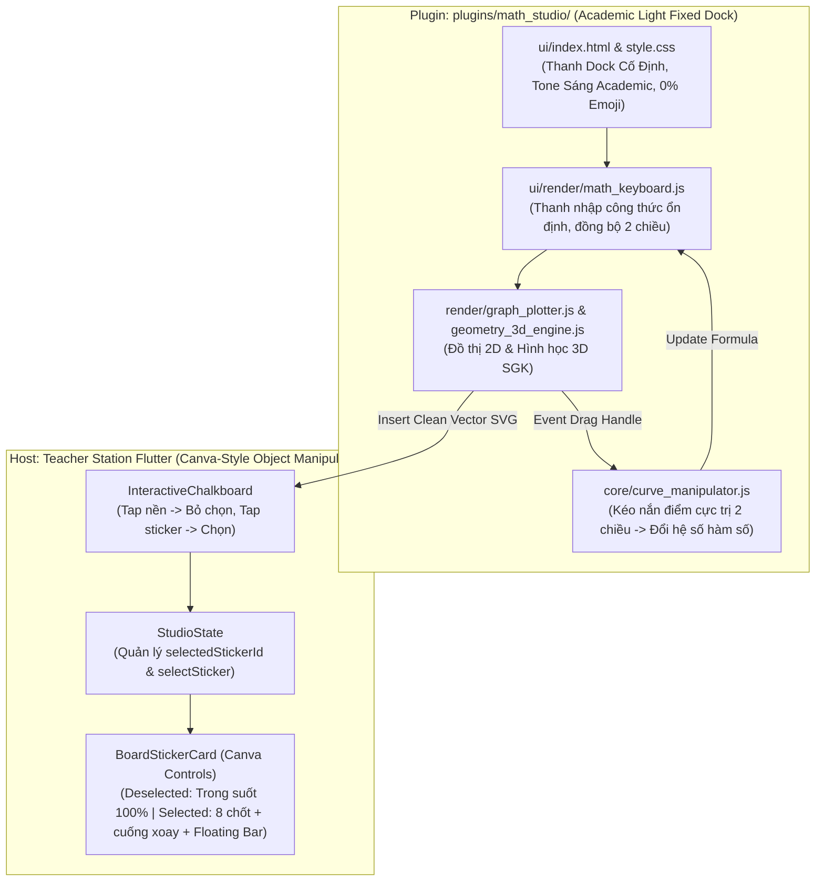

# Plan: Học Lực Math Studio UI Refactor (Canva-Style Object Manipulation & Academic Fixed Dock)

**Date:** 2026-10-25  
**Mode:** Hard  
Risk: normal — multi-file UI/UX refactor (frontend Flutter sticker card selection & handles, plugin CSS/HTML dock, gesture event handling), fully testable with existing widget and node tests, no schema or auth risk.  
**Domain Focus:** Thiết kế Học thuật (Academic Light Palette), Thanh Dock cố định tối giản, Transform Controls 8 chốt + Cuống xoay chuẩn Canva trên Bảng Phấn, Kéo nắn điểm cực trị 2 chiều (Inverse Curve Fitting)  
**Spec:** [plans/math-studio-ui-refactor/spec.md](spec.md)  
**Report:** [plans/reports/261025-math-studio-ui-canva-dock-brainstorm.md](../reports/261025-math-studio-ui-canva-dock-brainstorm.md)

---

## Architecture & Technical Flow

---

## Phase Breakdown

- [x] **[Phase 1: Thanh Dock Toán Học Cố Định & Chuẩn Hóa Học Thuật](phase-01-academic-fixed-dock.md)**
  - *Covers:* FR-01, FR-02, FR-06, P1-US01, P1-US02.
  - Chuyển layout `index.html` và `style.css` sang dạng Thanh Dock cố định, màu sáng academic (`#FFFFFF`, `#F8FAFC`, `#0F172A`).
  - Gỡ bỏ 100% emoji và text rườm rà; thay bằng vector icons thanh mảnh.
  - Sửa lỗi ô nhập công thức: gõ phím liên tục không mất focus, không lỗi caret.
  - Chuẩn hóa tên thương hiệu: **Học Lực Math Studio** trong `manifest.json` và UI.

- [x] **[Phase 2: Phục Hồi & Tích Hợp Kéo Nắn Điểm Cực Trị 2 Chiều](phase-02-curve-manipulation-restore.md)**
  - *Covers:* FR-05, P1-US04.
  - Gắn sự kiện `pointerdown/move/up` vào các `.drag-handle` trên đồ thị.
  - Khi kéo chốt cực trị: Gọi `computeFormulaFromDrag` tính toán lại hệ số hàm số trong $< 2\text{ms}$.
  - Cập nhật ngược lại vào ô input và đồ thị mượt mà 60 FPS.

- [x] **[Phase 3: Canva-Style Transform Controls & Selection State trên Bảng Phấn](phase-03-canva-transform-controls.md)**
  - *Covers:* FR-03, FR-04, P1-US03.
  - Thêm `selectedStickerId` và `selectSticker(String? id)` vào `StudioState`.
  - Cập nhật `InteractiveChalkboard`: Nhấp vào vùng trống của bảng $\rightarrow$ bỏ chọn (deselect).
  - Cập nhật `BoardStickerCard`:
    - Trạng thái bình thường: 100% trong suốt, không viền, không header bar.
    - Trạng thái chọn: Bounding Box nét đứt cam ấm, 8 chốt kéo (4 góc tỉ lệ, 4 cạnh co giãn), 1 cuống xoay đỉnh $\theta \in [0^\circ, 360^\circ]$, và Floating Action Bar trên đầu: `[ ✎ Sửa ]`, `[ ⟳ Phát quay ]`, `[ ⧉ Nhân bản ]`, `[ 🗑 Xóa ]`.

- [x] **[Phase 4: Kiểm Thử Toàn Diện, Đóng Gói Plugin .hlep & Architecture Gate](phase-04-packaging-and-verification.md)**
  - *Covers:* Success Criteria, CI Invariants.
  - Cập nhật unit & widget tests cho `BoardStickerCard` với selection state và 8 chốt kéo.
  - Đóng gói `plugins/math_studio.hlep` phiên bản 2.1.0.
  - Xác minh `node scripts/validate_plugins.mjs`, `node scripts/run_architecture_check.mjs` và các test bộ máy toán học.

---

## Session Notes
<!-- Updated by cook automatically — do not edit manually -->

**Last active:** 2026-10-25 16:32  
**Phase in progress:** All Phases Complete (Phase 1 to Phase 4)  
**Status:** Successfully implemented Academic Fixed Dock, Canva-Style 8-Handle Transform Controls, 2-Way Curve Manipulation, and 12/12 Invariant Architecture Gate.  

### Decisions made this session
- Fully replaced previous modal window with an Academic Light Fixed Dock (`#FFFFFF`, `#F8FAFC`, `#0F172A`), stripping 100% of emojis and renaming branding to "Học Lực Math Studio".
- Restored direct pointer manipulation on `.drag-handle` extrema dots, linking to `computeFormulaFromDrag` at 60 FPS with immediate formula inverse-fitting.
- Implemented Canva-style selection architecture in Flutter: when deselected, stickers are completely borderless and seamless on the chalkboard; when tapped, 8 transform handles, top rotation stem, and floating context bar appear.
- Packaged plugin to `plugins/math_studio.hlep` (v2.1.0, 136 KB) passing all plugin integrity checks.

### Next immediate action
All phases completed and ready for direct teacher station usage.

### Next immediate action
All phases completed and ready for direct teacher station usage.

