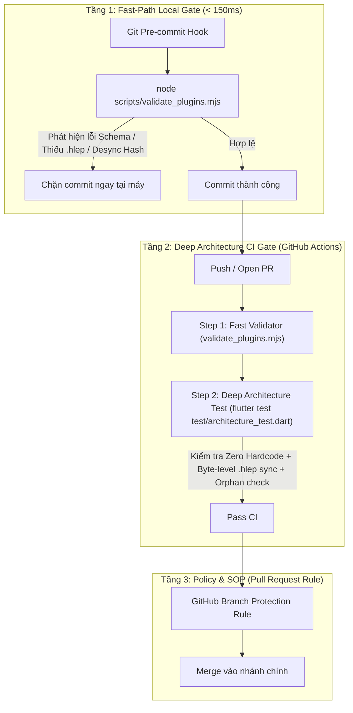

# Plan: Chuẩn Hóa Quy Trình Vòng Đời Plugin & Hệ Thống Chốt Chặn Đa Tầng (Plugin Lifecycle & CI Enforcement)

**Date:** 2026-10-19  
**Mode:** --hard  
**Risk:** normal — Thiết lập script git hooks, bổ sung CLI validator, tăng cường test kiến trúc và hoàn thiện tài liệu SOP; không làm thay đổi core runtime hay DB.  

---

## 1. Executive Summary & Architecture Blueprint

Xây dựng hệ thống phòng thủ đa tầng (**Defense-in-Depth**) ép buộc mọi lập trình viên và AI Agent khi **THÊM - SỬA - XÓA** plugin phải tuân thủ nghiêm ngặt chuẩn kiến trúc Microkernel (Schema v2.1, Zero-hardcode, Freshness của gói `.hlep`):

---

## 2. Phases Overview & Story Coverage

| Phase | Title | Scope & Output Files |
| :--- | :--- | :--- |
| **Phase 01** | Fast CLI Validator & Hash Freshness | Xây dựng CLI Node.js siêu nhẹ `scripts/validate_plugins.mjs` (Zero-dependency, <150ms). Kiểm tra Schema v2.1, tính toàn vẹn file UI/entry, so sánh thời gian mtime/hash để phát hiện desync giữa source và `.hlep`, hỗ trợ cờ `--fix` tự repackage. |
| **Phase 02** | Cross-Platform Git Pre-Commit Hook | Tạo thư mục `.githooks/` dùng `core.hooksPath`, viết wrapper hook chạy được trên cả Windows và Linux/macOS, cấu hình `.gitattributes` khóa `eol=lf` chống lỗi `CRLF (^M)`, in thông báo actionable hướng dẫn sửa lỗi rõ ràng cho Agent. |
| **Phase 03** | Deep Dart Architecture Test Hardening | Nâng cấp `frontend/test/architecture_test.dart` (Bất biến 4) dùng package `archive` có sẵn để giải mã `.hlep` đối chiếu byte-level với thư mục nguồn; bổ sung Orphan Check bắt gói `.hlep` mồ côi khi thư mục plugin bị xóa. |
| **Phase 04** | CI Workflow Integration & SOP Rule Docs | Cập nhật `.github/workflows/ci-frontend.yml` chạy fast validator trước test suite; hoàn thiện tài liệu `AGENTS.md`, `.agents/rules/plugin_development_rules.md`, `docs/architecture/plugin-development-guide.md` kèm PR Checklist bắt buộc. |

---

## 3. Risks & Mitigations

1. **Rủi ro lỗi xuống dòng trên Windows (`/bin/sh^M: bad interpreter`)**:
   * *Nguyên nhân*: Git trên Windows lưu file hook với ký tự CRLF làm Linux bash gãy.
   * *Giải pháp*: Khóa `.githooks/* text eol=lf` trong `.gitattributes`.
2. **Rủi ro AI Agent lách luật bằng `git commit --no-verify`**:
   * *Nguyên nhân*: Agent không hiểu thông báo lỗi mơ hồ nên cố bypass.
   * *Giải pháp*: Script CLI in sẵn câu lệnh khắc phục chính xác (ví dụ: `👉 FIX: Run 'node scripts/package_plugin.mjs <name>'`); đồng thời CI trên GitHub là chốt chặn cuối không thể bypass.
3. **Rủi ro Monorepo CWD Path Traversal**:
   * *Nguyên nhân*: Dev chạy lệnh từ `frontend/` thay vì thư mục gốc.
   * *Giải pháp*: Dùng `import.meta.url` trong script Node để luôn định vị chính xác project root.
4. **Rủi ro sai khác Byte Length do CRLF/LF giữa Windows và CI (Red-Team Finding)**:
   * *Nguyên nhân*: Git autocrlf có thể thay đổi byte length của file text giữa lúc commit và lúc giải nén zip.
   * *Giải pháp*: Khóa cứng `.gitattributes` cho `plugins/** text eol=lf` để mọi file text trong plugin luôn đồng nhất LF trên cả Windows và Linux.

---

## 4. Verification Gate

- Chạy `node scripts/validate_plugins.mjs` -> Trả về `0 errors` (kết quả hiển thị xanh).
- Sửa thử 1 file trong `plugins/casio_calculator/ui/` mà không đóng gói -> Chạy `validate_plugins.mjs` phải bắt được lỗi OUT_OF_SYNC.
- Chạy `flutter test test/architecture_test.dart` trong `frontend/` -> 100% tests PASS.
- Thử tạo 1 file `.hlep` mồ côi -> Test báo lỗi Orphan package ngay lập tức.
