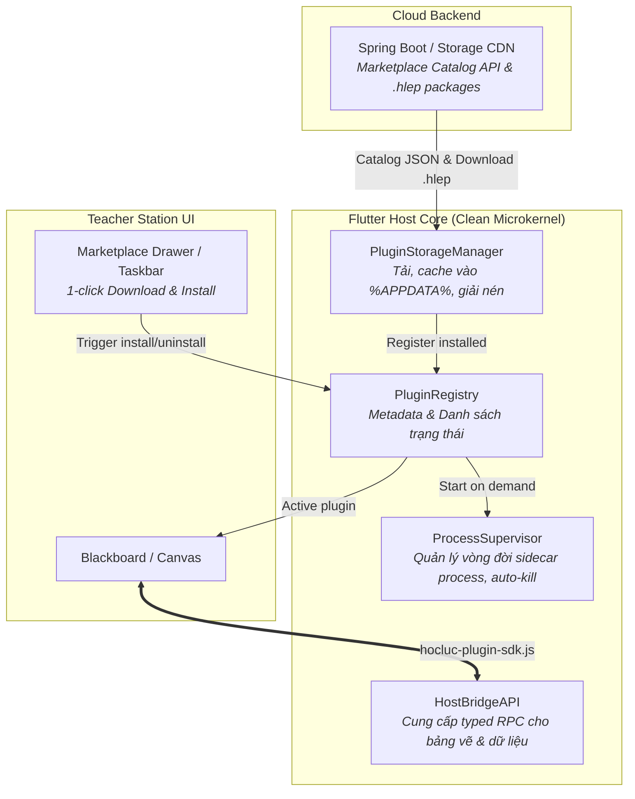

# Brainstorm: Tái cấu trúc Hệ thống Plugin & Cloud Marketplace cho Teacher Station

**Date:** 2026-10-15  
**Author:** Pair Programming Session with Lead Architect

---

## 1. Ideas Explored

1. **Giữ nguyên Kiến trúc Hiện tại (In-Memory + Ad-hoc)**:
   - *Mô tả*: Đọc toàn bộ file ZIP `.hlep` nhét vào `Map<String, Uint8List>` trong RAM, hardcode các đường dẫn `english_assistant` trong code Flutter.
   - *Đánh giá*: Bị loại bỏ vì vi phạm nghiêm trọng OOP/SOLID, rò rỉ logic chuyên biệt của tiếng Anh vào Core Studio, phình RAM khi có nhiều plugin và không thể scale cho các dev khác làm việc độc lập.

2. **100% Pure Cloud Streaming (Micro-Frontend + Server AI)**:
   - *Mô tả*: Webview mở URL CDN, mọi tác vụ AI chuyển lên máy chủ Cloud backend.
   - *Đánh giá*: Tiết kiệm 100% ổ đĩa nhưng tiềm ẩn rủi ro lớn khi mạng trường học chập chờn (giáo viên không giảng bài được) và chi phí vận hành máy chủ AI tăng phi mã.

3. **Cloud Marketplace + On-Demand Cache (Mô hình VS Code / App Store) — [ĐƯỢC CHỌN]**:
   - *Mô tả*: Ứng dụng gốc cực kỳ gọn nhẹ; trên thanh công cụ/drawer có giao diện Marketplace hiển thị danh mục plugin trên mây. Giáo viên cần môn nào chỉ bấm "Tải về" (1-click), hệ thống tự tải gói `.hlep` về thư mục người dùng (`%APPDATA%`), tự giải nén và kích hoạt. Khi mở thì nạp lên RAM, khi đóng thì giải phóng tài nguyên.

---

## 2. User's Direction & Mental Model

- **Tiêu chí tối thượng**: "Nhanh - Tiện - Gọn".
- **Trải nghiệm giáo viên**:
  - Giáo viên chỉ cần cài duy nhất ứng dụng Học Lực Teacher Station là chạy được ngay, không yêu cầu cài môi trường phức tạp (như Python, Node.js).
  - Giao diện Taskbar/Drawer có nút mở Kho Plugin (Marketplace).
  - Plugin nào cần thì bấm "Tải về" -> Tự động nạp và sẵn sàng sử dụng.
  - Không tải trước toàn bộ các môn khác để tránh làm nặng máy cho những môn giáo viên không bao giờ dùng tới.
- **Tính hướng đối tượng (OOP) & Quy chuẩn đội ngũ Dev**:
  - Loại bỏ hoàn toàn mã hardcode tên plugin trong Flutter Core (`frontend/lib`).
  - Thiết lập chuẩn **Host-Plugin Bridge (SDK)** và **Schema Manifest v2**.
  - Phân tách rõ ràng giữa `PluginRegistry`, `PluginStorageManager`, `ProcessSupervisor` và `HostBridgeAPI`.

---

## 3. Kiến trúc Đề xuất (Target OOP Architecture)

---

## 4. Open Questions for $bb-plan

1. **Định dạng đóng gói Sidecar nhị phân**: Với các plugin AI dùng Python, ưu tiên đóng gói bằng PyInstaller binary độc lập (chạy trực tiếp không cần Python máy khách) hay chuyển các model NLP này thành API tiện ích nhẹ?
2. **Server lưu trữ ban đầu cho Marketplace**: Sẽ cấu hình endpoint trong Spring Boot (`/api/v1/plugins/marketplace`) hay sử dụng static JSON catalog trên Cloud Storage/CDN trước?
3. **Chiến lược Migration**: Di chuyển plugin hiện tại `english_assistant` thành plugin tham chiếu (Golden Sample) theo chuẩn Manifest v2 và HostBridge SDK mới.

---

## 5. Top Risks

1. **Dung lượng file `.hlep` chứa AI Engine**: Nếu nhúng cả binary Python/spaCy vào gói `.hlep`, file tải về có thể nặng (khoảng 80MB - 150MB). Cần hiển thị thanh tiến trình download rõ ràng và hỗ trợ resume download nếu mất mạng giữa chừng.
2. **Quyền ghi thư mục trên Windows**: Một số máy tính trường học bị giới hạn quyền Admin, do đó bắt buộc phải lưu plugin vào thư mục người dùng chuẩn (`%LOCALAPPDATA%\HocLuc\plugins`) thay vì thư mục `Program Files`.
3. **Quản lý tiến trình Zombie trên Windows**: Cần cơ chế Windows Job Object hoặc heartbeat song công (bi-directional ping) giữa Flutter và Sidecar process để đảm bảo khi app tắt đột ngột thì engine sidecar luôn được tắt sạch.
