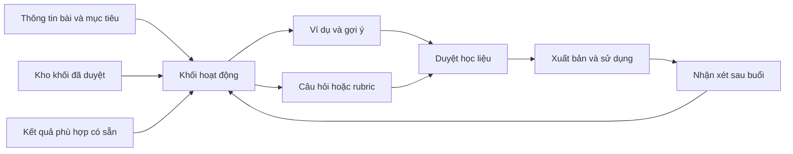

# Ý tưởng bổ sung cho Soạn bài HocLuc

> Bổ sung sau phản hồi của người dùng: đây là nguồn ý tưởng tham khảo. Kế hoạch cho phần **SOẠN BÀI của app** nằm tại [plan hiện hành](../lesson-preparation-app/plan.md), tổ chức theo màn hình, thao tác và luồng dữ liệu; không triển khai 12 mục như 12 module.

Ngày: 2026-10-19. Trạng thái: nghiên cứu và đề xuất, chưa triển khai.
Yêu cầu: tìm kiếm, suy nghĩ và đề xuất trong tối đa 30 phút; bắt đầu 20:05:42 giờ Việt Nam, hạn 20:35:42.
Đối tượng: giáo viên phổ thông, giảng viên đại học; giáo viên thao tác trong HocLuc, học sinh không cần cài app.

## Kết luận đề xuất

Nên phát triển Soạn bài thành không gian **thiết kế việc học**: mục tiêu cần đạt, hoạt động để đạt mục tiêu, ví dụ và câu hỏi giúp hiểu bài, bằng chứng cần quan sát, cải tiến sau khi dạy. Video/giọng đọc là một loại học liệu trong quy trình đó.

Năm ưu tiên chung: **I02 khối hoạt động → I01 bản đồ mục tiêu → I09 ví dụ giảm dần hỗ trợ → I05 thẻ hiểu sai → I08 phản hồi sau tiết dạy**. Thứ tự là nhận định sản phẩm từ code và tài liệu, chưa có dữ liệu đo nhu cầu/thời gian tiết kiệm của người dùng HocLuc.

I04 (kết quả kiểm tra → bài củng cố) là pilot riêng đáng làm sớm nếu lớp đã có dữ liệu chi tiết phù hợp. Không lấy nó làm điều kiện để giảng viên hoặc giáo viên môn khác sử dụng Soạn bài.

Không triển khai cả 12 mục cùng lúc. Các mục dưới đây là backlog ý tưởng; cần thử với giáo viên thật trước khi chuyển thành cam kết roadmap.

## Cách nghiên cứu và giới hạn

- Đọc code Planning, Studio notes/PDF, exam bank/papers/analytics, model metadata và kế hoạch Soạn bài AI trước đó.
- Tìm nguồn gốc từ trung tâm giảng dạy đại học, IES, CAST, NSW Education; đối chiếu tài liệu chính thức của sản phẩm hiện hành và hai nghiên cứu HCI.
- Phân biệt hướng dẫn sư phạm, quan sát nghiên cứu nhỏ và quảng bá sản phẩm. Không lấy số liệu marketing về thời gian tiết kiệm làm KPI HocLuc.
- Không phỏng vấn người dùng, không chạy app hoặc làm usability test trong nghiên cứu này. “Chưa thấy” là kết quả kiểm tra đường code liên quan, không phải chứng minh mọi nhánh/git history đều chưa có.
- Không chọn dịch vụ cloud, không gửi dữ liệu giáo viên/học sinh lên dịch vụ ngoài. Tìm kiếm web chỉ dùng truy vấn khái quát và tên nguồn công khai.

## 1. Những phần không tính lại là ý tưởng mới

| Nhóm | Hiện trạng đã kiểm tra | Cách dùng trong đề xuất |
|---|---|---|
| Lưu/mở/xóa bài, dạy từ bản soạn | [PlanningService](../../backend/api/src/main/java/vn/teaching/service/PlanningService.java), [PlanningController](../../backend/api/src/main/java/vn/teaching/controller/PlanningController.java) | Tái sử dụng, không tạo CRUD thứ hai. |
| Board, PDF, ghi chú theo trang, xuất PDF/handout | [StudioSpeakerNotesBar](../../frontend/lib/features/studio_board/presentation/studio/studio_speaker_notes_bar.dart), [PDF exporter](../../frontend/lib/features/studio_board/services/pdf_annotation_exporter.dart), [handout exporter](../../frontend/lib/features/studio_board/services/pdf_annotation_handout_exporter.dart) | Mở rộng nội dung/cách tổ chức. Handout hiện có notes nên không coi là bản học sinh mặc định. |
| Kho câu hỏi, đề theo ma trận, nhiều mã đề, bộ ôn | [ExamModels](../../backend/api/src/main/java/vn/teaching/exam/ExamModels.java), [PaperService](../../backend/api/src/main/java/vn/teaching/exam/PaperService.java) | Gắn câu đã duyệt vào activity; không đề xuất thêm ngân hàng/engine tạo đề. |
| Điểm/kỹ năng/chủ đề và gợi ý câu ôn | [AnalyticsService](../../backend/api/src/main/java/vn/teaching/exam/AnalyticsService.java) | Chỉ mới khi nối thành bài dạy có giải thích, ví dụ, hoạt động. |
| Phân tích tiếng Anh, CEFR, cloze | [DgnlService](../../frontend/lib/features/studio_board/services/dgnl_service.dart) | Năng lực chuyên môn tái sử dụng qua ranh giới phù hợp; không hardcode môn/plugin trong core. |
| Video/script/prompt → giáo án/animation, STT/dịch/TTS, đăng Classroom, notes riêng | [Spec Soạn bài AI](../lesson-preparation-ai/spec.md) | Requirement trước, không đếm là ý tưởng bổ sung. |
| Glossary, nguồn timestamp, rehearsal, revisions, tái tạo scene, caption, preflight | [Phase 06 trước đó](../lesson-preparation-ai/phase-06-preparation-extensions.md) | Đã có trong kế hoạch; không đổi tên rồi tính mới. |
| OCR và hợp tác nhiều giáo viên | [Spec AI](../lesson-preparation-ai/spec.md), [Spec planning cũ](../lesson-planning/spec.md) | Khoảng trống/hướng mở rộng đã nhận diện, không tính là phát hiện mới. |

Planning metadata hiện chỉ có id, title, subject, pageCount, timestamps và teacherId phía backend; xem [Planning](../../backend/api/src/main/java/vn/teaching/model/Planning.java) và [PlanningMeta](../../frontend/lib/features/classroom_meet/domain/models/planning_meta.dart). Nội dung JSON linh hoạt nhưng chưa thấy hợp đồng mục tiêu–activity–minh chứng trong đường đã kiểm tra.

## 2. Bằng chứng và hàm ý thiết kế

**Thiết kế ngược và liên kết mục tiêu.** CMU hướng dẫn nối mục tiêu, hoạt động và đánh giá; Cornell bắt đầu thiết kế môn học từ kết quả mong muốn. Suy luận cho HocLuc: giúp giáo viên nhìn ra chỗ thiếu liên kết, không chỉ sinh thêm văn bản. [CMU](https://www.cmu.edu/teaching/assessment/basics/alignment.html), [Cornell](https://teaching.cornell.edu/teaching-resources/preparing-teach/designing-your-course).

**Hoạt động cần hướng dẫn thực hiện.** Cornell mô tả các hoạt động ngắn và yêu cầu tính thời gian phù hợp. Suy luận: mỗi khối bài phải có việc giáo viên/học sinh làm, vật liệu và dấu hiệu hoàn thành. [Cornell active learning](https://teaching.cornell.edu/teaching-resources/active-collaborative-learning/active-learning/getting-started-active-learning).

**Luyện tập có cấu trúc.** Hướng dẫn IES đề cập ôn cách quãng, xen ví dụ giải với tự giải, kết nối cụ thể–trừu tượng và câu hỏi giải thích. NSW Education nhấn mạnh điều chỉnh lượng hỗ trợ theo kiến thức sẵn có. Các mức bằng chứng khác nhau giữa khuyến nghị; đây không phải chứng minh tính năng HocLuc sẽ tăng điểm. [IES](https://ies.ed.gov/ncee/wwc/PracticeGuide/1), [NSW](https://education.nsw.gov.au/about-us/education-data-and-research/cese/publications/practical-guides-for-educators/cognitive-load-theory-in-practice).

**Nhiều đường tham gia/thể hiện.** CAST hỗ trợ lựa chọn cách biểu đạt và hỗ trợ tăng dần. Suy luận: biến thể hoạt động nên giữ mục tiêu chung, không gán cố định học sinh vào “phong cách học” hoặc tự chẩn đoán năng lực. [CAST UDL 3.0](https://udlguidelines.cast.org/action-expression/).

**Giảng viên cần nhiệm vụ vận dụng.** CMU có hướng dẫn rubric; Harvard mô tả dạy bằng case. Suy luận: thêm loại activity case/rubric trong cùng editor, không cần một hệ nộp/chấm bài mới. [CMU rubric](https://www.cmu.edu/teaching/assessment/assesslearning/rubrics.html), [Harvard cases](https://bokcenter.harvard.edu/cases).

**Giao diện có cấu trúc thay vì mọi việc qua chat.** LessonPlanner (2024) nghiên cứu within-subject N=12, phần người tham gia đánh giá gồm sinh viên đại học năm cao/học viên cao học đóng vai giáo viên; không phải thử nghiệm kết quả học sinh. LessonBuilder preprint ngày 09/10/2026 báo cáo nghiên cứu định tính với 8 giáo viên tin học trung học. Hai nguồn gợi ý giữ quyền chỉnh sửa/đánh giá ở giáo viên, nhưng phạm vi nhỏ, không suy rộng cho toàn bộ giáo viên Việt Nam. [LessonPlanner](https://arxiv.org/abs/2408.01102), [LessonBuilder](https://arxiv.org/abs/2610.12834).

**Tham khảo sản phẩm, không sao chép lời hứa.** MagicSchool mô tả mục tiêu/chuẩn và biến thể bài; Brisk mô tả tái sử dụng tài liệu, điều chỉnh nội dung và kết nối workflow; Curipod mô tả sinh bài có slide/hoạt động. Đây là thông tin nhà cung cấp, không phải đánh giá độc lập. Không giả định có API/SDK, quyền nhúng hoặc khả năng tích hợp chúng vào HocLuc. [MagicSchool](https://www.magicschool.ai/tools/lesson-plan), [Brisk](https://www.briskteaching.com/faq), [Curipod](https://help.curipod.com/en/articles/739581-how-do-i-create-a-lesson-in-curipod).

## 3. Mười hai ý tưởng cụ thể

### I01 — Bản đồ mục tiêu → hoạt động → minh chứng

**Nhu cầu:** biết bài dạy có thực sự phục vụ mục tiêu đã chọn, tránh đủ slide nhưng thiếu luyện tập/kiểm tra.

Trong app, giáo viên nhập mục tiêu từ đề cương hoặc tự viết; gắn activity và câu hỏi/sản phẩm vào từng mục tiêu. App báo “mục tiêu 2 chưa có hoạt động luyện tập” hoặc “chưa có cách quan sát hiểu bài”. Giảng viên có thể gắn CLO/PLO do cơ sở cung cấp; giáo viên phổ thông dùng mục tiêu/yêu cầu cần đạt. Không bắt dùng cùng thuật ngữ.

**Ví dụ:** mục tiêu “giải thích vì sao kết quả thay đổi” nhưng chỉ có câu nhớ định nghĩa: app đưa gợi ý cần giáo viên xem lại, không tự kết luận đạt/chưa đạt chuẩn.

Kiểm tra thiếu ID/liên kết là quy tắc xác định. Nhận xét “câu hỏi chưa đúng cấp độ tư duy” là đề xuất sư phạm cần giáo viên xác nhận; test graph không chứng minh nhận xét ấy đúng.

**Tính mới:** liên kết sư phạm có ID; khác tag skill/topic của câu hỏi và preflight media. **Nền:** editor/link/check thiếu xác định; AI gợi ý tùy chọn. **Ưu tiên:** P1. **Nghiệm thu:** với 3 mục tiêu và 2 liên kết thiếu được cài trước, app chỉ đúng 2 chỗ; sửa mục tiêu không âm thầm sửa câu hỏi.

### I02 — Khối hoạt động có thể tổ chức thành tiết dạy

Mỗi khối chứa mục tiêu, thời lượng dự kiến, việc giáo viên làm, việc học sinh làm, vật liệu, câu kiểm tra hiểu và sản phẩm mong đợi. Các loại cơ bản: mở bài, giải thích, ví dụ, luyện tập, thảo luận, kiểm tra nhanh, kết bài. Giáo viên sắp xếp khối, đặt phần bắt buộc/tùy chọn và ngân sách 45/90 phút. Tổng phút tính cả chuyển hoạt động, không chỉ lời đọc.

**Ví dụ:** sau đoạn giải thích, chèn “2 phút dự đoán theo cặp”, kèm câu hỏi học sinh và hướng dẫn/đáp án riêng. Dùng lời nói, bảng, giấy hoặc Classroom thông thường; không phát sinh app trả lời học sinh.

**Tính mới:** phase authoring cũ có nhắc hoạt động nhưng chưa mô tả cấu trúc vận hành/checkpoint như trên; đây là mở rộng, không một module độc lập. Khác rehearsal video là lập kế hoạch hoạt động trước giờ dạy. **Ưu tiên:** P1, nền cho nhiều mục khác. **Nghiệm thu:** tổng 48 phút của tiết 45 được báo rõ; xóa/đổi thứ tự khối không mất notes, nguồn hoặc liên kết mục tiêu. Không ép một mô hình sư phạm duy nhất cho mọi môn.

Có thể mở bài Planning/PDF cũ và thêm hai activity dần dần; không ép chuyển toàn bộ tài liệu thành schema mới mới được lưu/dạy. Một bài có thể dùng qua nhiều buổi; một buổi có thể dùng nhiều bài. `LessonUse` giữ revision và các activity thực dùng, không đồng nhất lesson với session.

### I03 — Các nhánh hỗ trợ / chuẩn / mở rộng cùng mục tiêu

Từ một activity, giáo viên tạo lựa chọn hỗ trợ (gợi ý, từ khóa, ví dụ), chuẩn và mở rộng (đổi điều kiện/vận dụng). App cho so sánh khác biệt, khóa nội dung chung và chọn bản dùng cho lớp. Có thể thiết kế cách trả lời bằng sơ đồ hoặc văn bản nếu phù hợp mục tiêu; không thay nhiệm vụ nói bằng viết khi mục tiêu cần năng lực nói.

**Tính mới:** biến thể cách học, không phải đổi mã đề, dịch ngôn ngữ hay phân tích CEFR. **Ưu tiên:** P2 sau schema activity. **Nghiệm thu:** ba nhánh giữ cùng objectiveId, sửa một nhánh không ghi đè nhánh còn lại; luôn nhìn thấy phần tăng/giảm hỗ trợ. **Giới hạn:** không tạo ba bộ tài liệu đầy đủ mỗi lần, không gán nhãn học sinh yếu/mạnh tự động; tránh nhân ba việc duyệt.

### I04 — Từ bằng chứng kiểm tra thành bài củng cố

Trong Soạn bài, giáo viên chọn lớp/kỹ năng có dữ liệu phù hợp; xem số câu và khoảng thời gian; chọn “Soạn bài củng cố”. Draft có mục tiêu nhắc lại, ví dụ giải thích, luyện có hỗ trợ, câu kiểm tra lại và nguồn số liệu. Giáo viên duyệt mọi mục.

**Tính mới:** AnalyticsService đã có khuyến nghị và PaperService đã tạo bộ ôn; phần mới là thiết kế **bài dạy** từ bằng chứng ấy. **Ưu tiên:** P2/pilot sớm có điều kiện. **Giới hạn:** hiện gợi ý kỹ năng ở analytics yêu cầu ít nhất 10 câu chi tiết và tỷ lệ đúng dưới 60%; đây là rule code hiện tại, không chứng nhận mastery. Không áp V-ACT/HSA sang môn đại học tùy ý; không suy kỹ năng từ điểm tổng.

**Nghiệm thu:** trường hợp chỉ có tổng điểm không sinh kết luận kỹ năng; draft ghi đúng dữ liệu nguồn và thời điểm; không đưa tên/điểm cá nhân vào bản học sinh. Phải ánh xạ class/teacher identity của hai module qua service contract, không tin nhãn email hay tự bỏ kiểm quyền.

### I05 — Thẻ hiểu sai, phản ví dụ và gợi ý từng bước

Mỗi khái niệm có thẻ riêng cho giáo viên: hiểu sai có thể gặp, câu hỏi phát hiện, phản ví dụ, lời giải thích và ba mức gợi ý. Giáo viên soạn trước và gắn thẻ vào activity, khi dạy mở ngay cùng màn hình. App không khẳng định học sinh đang mắc lỗi đó khi chưa có bằng chứng.

**Ví dụ:** học sinh có thể nhầm trung bình với trung vị; thẻ chứa bộ dữ liệu phản ví dụ do giáo viên duyệt và câu hỏi dẫn dắt. Đây là nội dung minh họa thiết kế, không bản học liệu đã nghiệm thu.

**Tính mới:** notes đã có nhưng chưa có cấu trúc misconception/detection/hint; tận dụng notes thay xây chatbot riêng. **Ưu tiên:** P1 sau I02. **Nghiệm thu:** thẻ lưu gắn đúng khái niệm/khối; chỉ câu/gợi ý được giáo viên chọn mới sang student view, đáp án và hiểu sai giả định ở teacher view. Sinh nháp cần LLM bổ sung, kiểm đúng bởi giáo viên.

### I06 — Thư viện khối sư phạm dùng lại

Giáo viên lưu một ví dụ, activity, câu mở bài hoặc chuỗi gợi ý vào thư viện cá nhân; tìm theo chủ đề, mục tiêu, thời lượng và điều kiện. Chèn vào bài khác dưới dạng bản sao hoặc liên kết phiên bản rõ ràng. Nguồn và điều kiện sử dụng đi cùng nội dung.

**Tính mới:** reuse một đơn vị sư phạm, khác clone nguyên bài và template animation. **Ưu tiên:** P2 khi khối đã ổn định; chức năng “lưu khối/chèn bản sao” có thể pilot cùng I02. **Nghiệm thu:** sửa bản sao không thay bài gốc; bản liên kết chỉ cập nhật sau giáo viên chấp nhận diff. Chưa làm marketplace/cộng tác realtime. OER Commons là nguồn tham khảo cách giữ bản gốc khi remix, không mặc định mọi tài nguyên đều được sửa hoặc có API tích hợp. [OER Commons](https://help.oercommons.org/support/solutions/articles/42000046860-remix-a-resource).

### I07 — Chuỗi bài, kiến thức tiên quyết và ôn phân bố

Giáo viên nhìn một chủ đề/học phần theo buổi, nối điều kiện tiên quyết, gắn mục tiêu từng buổi và chọn nội dung cần nhắc lại ở các buổi sau. App gợi ý chỗ chèn câu ôn vào bài đang soạn; giáo viên xác nhận lịch và câu hỏi.

**Tính mới:** quan hệ học thuật giữa các bài, khác Calendar mời lịch hoặc báo thời lượng một video. **Ưu tiên:** P2 muộn vì cần mục tiêu và dữ liệu các buổi chuẩn hóa. **Nghiệm thu:** phát hiện vòng prerequisite, giải thích vì sao đề xuất câu ôn, cho hoãn/đổi; không sinh sự kiện Calendar hay thông báo tự động cho học sinh khi chưa có yêu cầu. Không áp lịch 1–3–7 ngày hoặc một thuật toán thích ứng như quy luật tối ưu phổ quát.

### I08 — Phản hồi sau buổi dạy → việc cần sửa lần tới

Sau giờ dạy hoặc khi giáo viên quay lại Soạn bài, cung cấp form ngắn: “giữ lại”, “chưa rõ/cần ví dụ”, “vượt giờ”, “lần tới thay gì”. Mỗi nhận xét gắn đúng activity và revision đã dùng. Lần mở lại app hiện checklist; chọn từng mục để tạo đề nghị sửa, giáo viên chấp nhận trước khi thay bài gốc.

**Tính mới:** nguồn quyết định cải tiến từ thực dạy; khác lưu lịch sử revision và rehearsal. **Ưu tiên:** P1 nhưng nhỏ, không bắt ghi nhật ký dài. Có thể STT lời nhận xét riêng của giáo viên khi tính năng nguồn media đã sẵn sàng, không thu lén lời học sinh.

**Nghiệm thu:** ghi một phản hồi vào buổi A không làm đổi bài gốc; tạo draft sửa đúng activity; dismiss được. Không khẳng định nguyên nhân học sinh chưa hiểu từ cảm nhận của giáo viên; dùng nhãn “nhận xét giáo viên”.

### I09 — Ví dụ mẫu → khuyết bước → tự giải

Giáo viên nhập/chọn lời giải đã kiểm; đánh dấu bước và giải thích lý do. App tạo bản ví dụ đầy đủ, bản ẩn một số bước để luyện, và nhiệm vụ tự giải được giáo viên duyệt. Có thể gắn câu “vì sao làm bước này?” hoặc nối ký hiệu với hình/tình huống cụ thể.

**Tính mới:** chuỗi sư phạm theo bước; không chỉ sinh cloze tiếng Anh hay hiển thị lời giải đề thi. **Ưu tiên:** P1 sau I02. **Nghiệm thu:** ẩn/hiện bước là thao tác xác định; đáp án không vào bản luyện; mọi bước còn đúng thứ tự; biến thể AI phải được duyệt. Không áp cùng lượng hỗ trợ cho lớp mới học và lớp đã thành thạo.

Pilot một loại bài có lời giải theo bước trước; giữ công thức, bảng, đoạn code, hình, caption và citation bằng asset/block có kiểu, không chuyển mọi thứ thành văn bản thuần hoặc hứa mọi định dạng đều chỉnh sửa được. I05 bắt đầu bằng form thủ công, chưa cần engine tự suy luận lỗi sai.

### I10 — Case, seminar, thực hành và rubric cho giảng viên

Loại activity cho tình huống nhiều phương án: bối cảnh, dữ liệu/tài liệu, vai trò, câu hỏi dẫn, sản phẩm, tiêu chí đánh giá và gợi ý điều phối. Rubric là bảng tiêu chí/mức mô tả có trọng số tùy chọn, gắn mục tiêu; bài tập thực hành có vật liệu và các bước kiểm tra do giảng viên cung cấp.

**Tính mới:** mở rộng phương thức soạn nhiệm vụ ngoài MCQ/SHORT của kho thi hiện tại; không tạo portal nộp bài hoặc chấm tự động. **Ưu tiên:** P2, tăng lên nếu giảng viên là nhóm pilot chính. **Nghiệm thu:** trọng số hợp lệ khi bật tính điểm, mô tả mức không trống, mỗi tiêu chí truy về mục tiêu; xem trước bản sinh viên không chứa hướng dẫn đáp án riêng.

Mô phỏng ngành học có thể là nguồn cho một activity, nhưng tích hợp phải qua plugin/SDK có capability phù hợp; không hardcode website/môn/plugin vào core. PhET cung cấp hướng dẫn dùng mô phỏng cho K-12 và đại học; điều đó không chứng minh một simulator đã nhúng/chạy được trong HocLuc. [PhET](https://phet.colorado.edu/en/teaching-resources/planningToUsePhet).

### I11 — Xuất theo biểu mẫu trường/khoa do giáo viên cung cấp

Giáo viên chọn mẫu được cơ sở cung cấp và ánh xạ trường: mục tiêu, thiết bị, hoạt động GV/HS, sản phẩm, đánh giá, CLO nếu có. App báo trường thiếu và cho xem trước; lưu mapping cho lần sau. Bắt đầu bằng một mẫu thật có thể kiểm thử, không hứa mọi DOCX/PDF/bảng phức tạp.

**Tính mới:** field mapping và kiểm đủ thông tin theo mẫu, khác export PDF thông thường hoặc DOCX đề thi. **Ưu tiên:** P2/quick win theo nhu cầu cơ sở. **Nghiệm thu:** một bài xuất đúng mẫu mẫu thử đã duyệt, không mất tiếng Việt/công thức và không lẫn teacher notes sang bản công khai. Chưa xác minh yêu cầu pháp lý/biểu mẫu hiện hành toàn quốc; không gắn nhãn “đạt chuẩn Bộ” hoặc mặc định mẫu 5512 cho mọi cấp học.

### I12 — Phương án dự phòng cho từng hoạt động

Trong lúc soạn, giáo viên đánh dấu phụ thuộc Internet, âm thanh, máy chiếu, mô phỏng hoặc vật liệu. App giúp chuẩn bị hoạt động tương đương trên bảng/giấy và phương án rút ngắn khi mất thời gian, giữ mục tiêu trọng tâm. Chỉ thay thế sau giáo viên duyệt.

**Tính mới:** phương án sư phạm khi điều kiện đổi, khác tải model/offline caching đã có trong kế hoạch. **Ưu tiên:** P2. **Nghiệm thu:** một activity phụ thuộc Internet có Plan B gắn đúng objectiveId; kiểm được tài liệu cần chuẩn bị; không tự đổi toàn bộ tiết dạy hoặc tạo mode dạy thứ ba. Bài 45 phút rút 30 phút phải nêu mục tiêu/hoạt động không còn được bao phủ, không chỉ rút font/text.

## 4. Cách đưa vào app mà không thành 12 màn hình mới

Một lesson editor với các vùng Mục tiêu / Hoạt động / Học liệu / Kiểm tra / Xuất bản, không thêm một chatbot độc lập cho mỗi ý tưởng. Phản hồi sau buổi là lối quay lại bài, không thay đổi các điều khiển Meet. Mỗi lần chỉ tạo một bài cơ bản; các trường nâng cao, CLO, rubric, nhánh và nguồn dữ liệu mở khi cần.

Các entity gợi ý, **chưa là API/schema đã tồn tại**: `LessonBrief`, `LearningObjective`, `ActivityBlock`, `AssessmentLink`, `TeacherSupportCard`, `WorkedExampleStep`, `LessonUse`, `TeachingReflection`, `ReusableBlockReference`. Media/scene renderer đọc projection từ bài soạn, không buộc mọi activity phải có video.

Editor, tìm kiếm, link ID, tổng phút, so sánh bản, ẩn bước và xuất dữ liệu phải dùng được local không cần LLM. LLM authoring chỉ hỗ trợ đề xuất/viết nháp, dùng provider đã cấu hình và opt-in cloud nếu có. STT/dịch/TTS hiện tại không tự cung cấp lập luận sư phạm hoặc chứng minh nội dung đúng.

## 5. Thử nghiệm để quyết định làm gì trước

Đề nghị pilot 6 người (3 giáo viên phổ thông, 3 giảng viên) với bài thật đã bỏ thông tin riêng, mỗi người làm baseline và bản hỗ trợ trên hai chủ đề tương đương, đổi thứ tự để giảm hiệu ứng học công cụ. Đây là kế hoạch đánh giá đề xuất, chưa tuyển/đo.

Chỉ pilot lát cắt P1 nhỏ, không cả 12 ý tưởng: mở bài cũ → thêm hai activity và một mục tiêu → chuẩn bị một thẻ hỗ trợ → ghi nhận sử dụng → phản hồi → draft sửa. Baseline là workflow hiện tại của từng người, giữ mức hỗ trợ AI tương đương; ghi riêng thời gian học công cụ. Báo từng người/từng nhóm, chủ đề và thứ tự. Sáu người chỉ đủ nghiên cứu khả thi ban đầu, không dùng median chung để suy rộng hiệu quả cho hai nhóm nghề.

- Tác vụ 1: hoàn thành bài 45/90 phút từ mục tiêu và nguồn đã có; ghi thời gian bao gồm sửa nội dung AI.
- Tác vụ 2: phát hiện hai chỗ thiếu mục tiêu/minh chứng và một ví dụ sai được cài trong fixture.
- Tác vụ 3: tạo một hoạt động hỗ trợ, một checkpoint và bản học sinh không có đáp án.
- Tác vụ 4: ghi phản hồi sau buổi và tạo draft sửa mà không làm đổi bản đã dạy.

Mốc ra quyết định gợi ý: ít nhất 5/6 người hoàn tất các thao tác cốt lõi không cần người hỗ trợ; thời gian trung vị giảm ít nhất 20% so baseline khi tính cả duyệt/sửa; không tăng lỗi chuyên môn trọng yếu; không lọt notes/đáp án qua bất kỳ artifact thử nào. Đây là target sản phẩm cần điều chỉnh sau pilot, không phải kết quả đã đạt. Muốn kết luận về học sinh phải có nghiên cứu riêng.

I04 đánh giá riêng với fixture có/không có đáp án chi tiết, dưới ngưỡng bằng chứng và sai lớp/kỳ thi; không ép mọi người pilot phải dùng exam module.

## 6. Ý tưởng đã cân nhắc nhưng chưa nên ưu tiên

- Chatbot học sinh, portal học/nộp bài: ngoài ranh giới teacher-only hiện tại.
- Hệ chấm/rank năng lực hoặc nhận diện cảm xúc/chú ý tự động: thiếu dữ liệu, không giải quyết trọng tâm soạn bài.
- Video nhân vật/giọng clone làm điểm bắt đầu: đã có hướng giai đoạn sau, tăng chi phí và không thay thế cấu trúc bài dạy.
- Sinh kho câu hỏi thứ hai, analytics thứ hai, cloze/CEFR thứ hai: trùng code.
- Marketplace bài dạy hoặc co-edit realtime: hướng đã từng nêu; phức tạp quyền/sync, chưa cần trước reuse cá nhân.
- Bắt giáo viên nhập toàn bộ syllabus, mọi CLO/PLO hoặc profile từng học sinh mới được tạo bài: tăng ma sát; bắt đầu với một mục tiêu/một bài.
- Tự tìm mọi tài liệu mạng rồi gắn nhãn có bản quyền/đạt chuẩn: không có căn cứ. Thư viện ngoài chỉ là adapter được thẩm định, không scraper/login workaround.

## 7. Bàn giao

Đặc tả ứng viên: [spec.md](../lesson-preparation-expansion/spec.md). Không có thay đổi runtime, plugin, model weights hoặc luồng Google trong nghiên cứu này. Không thêm các ý tưởng chưa chọn vào feature_list như một cam kết triển khai.

Kết thúc tổng hợp và kiểm tra lúc khoảng 20:14 giờ Việt Nam, trong giới hạn 30 phút; không ghi nhận đã dùng trọn 30 phút. Review độc lập đối chiếu nguồn/code không còn điểm chặn trong tài liệu; các lưu ý về pilot nhỏ, semantic alignment và bài cũ đã được bổ sung.

Kiểm tra nền hiện tại: plugin validator đạt (2 plugins), architecture test 12/12, analyzer `--no-pub --no-fatal-infos` báo No issues found, `git diff --check` không có lỗi whitespace. Những gate này không chứng minh hiệu quả sư phạm hoặc tính năng đề xuất đã tồn tại. Tài liệu và local Markdown links đã được kiểm tra; không commit/push hay đổi nhánh.
