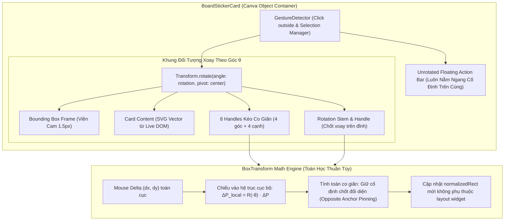

# Báo cáo Brainstorm: Live DOM SVG Extraction & Canva BoxTransform Engine

**Ngày:** 2026-10-26  
**Chủ đề:** Khắc phục lỗi hardcode kéo thả (Object Manipulation crash), giải quyết lỗi lặp lần 2 không tương tác được, và trích xuất trực tiếp DOM SVG từ panel Math Studio lên Bảng phấn.

---

## 1. Bản chất cốt lõi của 2 vấn đề

### Vấn đề 1: Đồ thị bị lệch giao diện do "tự build lại SVG lần 2"
- **Hiện trạng:** Khi người dùng bấm "Xong / Ghim lên bảng", hệ thống lại gọi hàm `generateGraphSvg()` trong `graph_plotter.js` để tự tính toán và vẽ lại một chuỗi SVG mới toanh, thay vì lấy chính xác đối tượng mà JSXGraph đã render trên màn hình panel.
- **Hệ quả:** Phát sinh 2 bộ render song song (1 cho panel và 1 cho bảng phấn), dẫn đến màu sắc, nhãn mác, tỷ lệ trục tọa độ bị lệch nhau, khó bảo trì.
- **Giải pháp (Cách A):** **Live DOM SVG Extraction**. Khi bấm "Ghim", lấy trực tiếp thẻ `<svg>` đang hiển thị trong container (`#graphContainer`, `#integralGraphContainer`, `#bbtContainer`, `#geometry3dContainer`), sao chép nguyên vẹn DOM SVG đó gửi qua Host Bridge lên Bảng phấn. Thấy gì trong panel thì lên bảng y hệt $100\%$.

---

### Vấn đề 2: Lỗi crash kéo thả (`shifted_box.dart: Failed assertion: line 111`) & Hardcode tĩnh
- **Hiện trạng:**
  1. 8 chốt kéo và 1 chốt xoay hiện được dựng bằng cách lồng các widget layout Flutter phức tạp (`OverflowBox`, `Center`, `Stack`) bên trong `Transform.rotate`.
  2. Khi `Transform.rotate` xoay một góc $\theta$, ma trận biến đổi tọa độ chuột (Hit-test matrix) xung đột với `childParentData.offset` của `OverflowBox`, kích hoạt:
     ```
     Another exception was thrown: 'package:flutter/src/rendering/shifted_box.dart': 
     Failed assertion: line 111 pos 18: 'transformed == position - childParentData.offset': is not true.
     ```
  3. Khi assertion này ném ra trong Flutter, cây bắt sự kiện chuột (Gesture Arena) bị đóng băng/hủy, dẫn đến **chỉ kéo được đúng 1 lần, lần sau ấn ra ngoài hay bấm lại đều bị đơ hoàn toàn**.
  4. Thanh công cụ nổi (`[Ghim | Sửa | Nhân bản | Xóa]`) bị xoay nghiêng ngả theo đồ thị, trong khi chuẩn Canva/Figma là thanh này luôn **nằm ngang cố định ở phía trên** để giáo viên luôn đọc và bấm được dễ dàng.
- **Giải pháp (Cách 1):** **Tích hợp Kiến trúc BoxTransform Chuẩn Canva**.

---

## 2. Thiết kế Kiến trúc BoxTransform Chuẩn Công Nghiệp



### Các nguyên tắc vàng:
1. **Thanh công cụ nổi nằm ngoài `Transform.rotate`:**
   - Luôn nằm ngang phía trên đối tượng (như Canva / Figma).
   - Tuyệt đối không bao giờ bị dính assertion `shifted_box.dart`.
2. **Chiếu Delta chuột qua ma trận nghịch đảo góc xoay $R(-\theta)$:**
   $$\begin{pmatrix} \Delta x_{local} \\ \Delta y_{local} \end{pmatrix} = \begin{pmatrix} \cos(-\theta) & -\sin(-\theta) \\ \sin(-\theta) & \cos(-\theta) \end{pmatrix} \begin{pmatrix} \Delta x \\ \Delta y \end{pmatrix}$$
   - Giúp việc kéo dãn 4 góc và 4 cạnh chuẩn xác tuyệt đối ở mọi góc xoay $0^\circ \to 360^\circ$ mà không bị nhảy toạ độ.
3. **Kéo góc khoá tỉ lệ (Aspect Ratio Lock), kéo cạnh dãn 1 chiều (Width/Height only):**
   - Giữ cố định điểm chốt đối diện (Opposite Anchor) để đồ thị phóng to/thu nhỏ mượt mà từ góc đối diện.
4. **Vòng đời chọn và bỏ chọn (Selection Lifecycle):**
   - Đảm bảo khi bấm ra ngoài bảng phấn, sticker deselect sạch sẽ; khi bấm lại vào bất kỳ đâu trên sticker, nó re-select ngay tức khắc và tiếp tục kéo xoay không giới hạn số lần.

---

## 3. Bản thiết kế trích xuất Live DOM SVG (Math Studio Plugin)

Thay vì gọi `generateGraphSvg()`:
```javascript
// Trích xuất trực tiếp Live SVG từ DOM container đang hiển thị
function exportLiveContainerSvg(containerEl, targetTheme = 'chalkboard') {
  const svgEl = containerEl.querySelector('svg');
  if (!svgEl) return null;
  
  // Clone element để không ảnh hưởng DOM preview đang hiển thị
  const clonedSvg = svgEl.cloneNode(true);
  clonedSvg.setAttribute('xmlns', 'http://www.w3.org/2000/svg');
  clonedSvg.setAttribute('width', '100%');
  clonedSvg.setAttribute('height', '100%');
  
  // Nếu xuất cho chalkboard, đảm bảo nền transparent
  clonedSvg.style.backgroundColor = 'transparent';
  
  return clonedSvg.outerHTML;
}
```

Ưu điểm vượt trội:
- **Zero Desync:** Đồ thị vẽ gì trên panel thì trên bảng nhận đúng $100\%$ từng pixel và mã màu.
- **Tiêu diệt 400 dòng code trùng lặp:** Không cần duy trì 2 hàm vẽ SVG độc lập.

