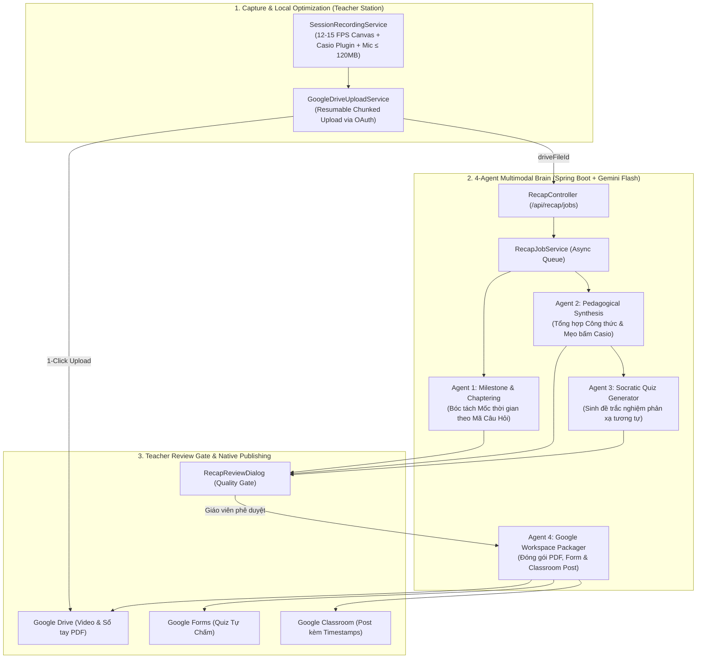

# Plan: Video-to-Interactive-Classroom-Recap (Trợ Giảng AI Bóc Tách Video Buổi Chữa Đề ĐGNL Thành Bộ Ôn Tập Google Classroom)

**Date:** 2026-10-20  
**Mode:** Hard  
**Risk:** high-risk — Touches external Google APIs (Drive, Classroom, Forms) and local Windows media capture  
**Domain Focus:** Luyện thi Đánh Giá Năng Lực (HSA / V-SAT / TSA) — 100% công nghệ hỗ trợ sư phạm, không quản trị  
**Spec:** [plans/video-to-interactive-classroom-recap/spec.md](spec.md)  
**Report:** [plans/reports/261020-video-to-interactive-classroom-recap-brainstorm.md](../reports/261020-video-to-interactive-classroom-recap-brainstorm.md)

---

## Architecture & Agentic Flow (Inspired by OpenMAIC)

---

## Phase Breakdown

- **[Phase 1: Backend Recap Module & 4-Agent Gemini Pipeline](phase-01-backend-recap-module-and-gemini-pipeline.md)**
  - *Covers:* P1 (Story 3), FR-03, FR-04.
  - Setup `vn.teaching.modules.recap` package, DTOs, Master `gemini.api-key` configuration, `RecapJobService`, `GeminiVideoAnalyzer` orchestrating Agent 1 (Question Timestamps), Agent 2 (LaTeX & Casio Shortcuts), Agent 3 (Socratic Quizzes), and `RecapController`.

- **[Phase 2: Backend Artifact Generators & Google Publisher](phase-02-backend-artifact-generators-and-google-publisher.md)**
  - *Covers:* P1 (Story 5), FR-05, FR-06, FR-08.
  - Implement `PdfSummaryGenerator` (Sổ tay mẹo giải ĐGNL dạng PDF), `GoogleFormsGenerator` (tạo Form trắc nghiệm phản xạ tự chấm), and `ClassroomPublisher` via existing `GoogleGateway`.

- **[Phase 3: Frontend Local Session Recording & Resumable Drive Upload](phase-03-frontend-session-recording-and-drive-upload.md)**
  - *Covers:* P1 (Story 1, Story 2), FR-01, FR-02.
  - Build `SessionRecordingService` (quay Studio Board + Plugin Casio FX-580 + Mic ở 12–15 FPS H.264/AAC $\le 120$MB/hour) và `GoogleDriveUploadService` (chunked resumable upload với quyền reader cho học sinh).

- **[Phase 4: Frontend Teacher Review Gate & Dashboard Integration](phase-04-frontend-teacher-review-gate-and-dashboard.md)**
  - *Covers:* P1 (Story 4), P2 (Story 7), FR-07.
  - Build `RecapReviewDialog` với trình sửa mốc câu hỏi, xem trước sổ tay PDF, sửa/đổi câu hỏi trắc nghiệm, và tích hợp các huy hiệu trạng thái vào `ClassroomDashboardScreen`.

- **[Phase 5: Verification, End-to-End Tests & CI Gates Hardening](phase-05-verification-and-ci-gates.md)**
  - *Covers:* All Success Criteria, 12/12 Architecture Invariants, 0 analyzer issues, 100% test pass.
  - Unit tests cho Backend (`mvn test`), Widget tests cho Frontend (`flutter test`), kiểm thử 12/12 Invariants kiến trúc.
