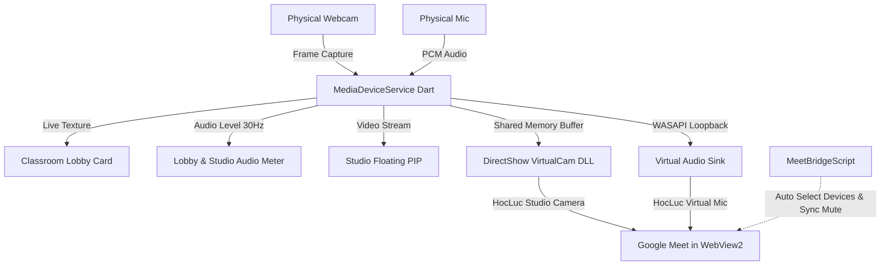

# Plan: Virtual Cam & Mic Transmission Pipeline for Teacher Station

**Date:** 2026-10-12
**Mode:** --hard
**Risk:** normal — touches media hardware, native C++ memory runner, and WebView2 bridge scripts.
**Spec:** `plans/virtual-cam-and-mic-pipeline/spec.md`

## Architecture Overview

## Phases
- [x] Phase 1: **[phase-01-media-device-service.md](file:///d:/Project/FptProject/HocLuc-TeacherStation-Flutter/plans/virtual-cam-and-mic-pipeline/phase-01-media-device-service.md)**: Hardware Device Discovery & Audio/Video Capture Service.
- [x] Phase 2: **[phase-02-lobby-and-studio-preview.md](file:///d:/Project/FptProject/HocLuc-TeacherStation-Flutter/plans/virtual-cam-and-mic-pipeline/phase-02-lobby-and-studio-preview.md)**: Classroom Lobby & Studio Floating PIP Live Preview UI.
- [x] Phase 3: **[phase-03-virtual-cam-and-mic-engine.md](file:///d:/Project/FptProject/HocLuc-TeacherStation-Flutter/plans/virtual-cam-and-mic-pipeline/phase-03-virtual-cam-and-mic-engine.md)**: DirectShow VirtualCam & Virtual Audio Sink Native Engine.
- [x] Phase 4: **[phase-04-meet-bridge-automation.md](file:///d:/Project/FptProject/HocLuc-TeacherStation-Flutter/plans/virtual-cam-and-mic-pipeline/phase-04-meet-bridge-automation.md)**: Google Meet Device Selection Automation & Synchronization.

## Verification Strategy
- **Unit & Widget Tests:** Automated testing with mock video textures, PCM buffers, and bridge scripts (`flutter test`).
- **End-to-End Test:** Run test verifying that Lobby preview renders, volume meter fluctuates on audio stream, and Meet bridge commands format correctly.
- **Resource Check:** Verify native DLL and asset overhead is strictly < 3 MB.

## Session Notes
<!-- Updated by cook automatically — do not edit manually -->

**Last active:** 2026-10-12 17:53
**Phase in progress:** Completed
**Status:** All 4 phases complete (102/102 tests passed, analyzer 0 issues).

### Decisions made this session
- Implemented `MeetBridgeScript` device priority enumeration to dispatch `MEET_MEDIA_DEVICE_SELECTED`.
- Added `setMicMute` and `setCamMute` to DOM bridge automation in Google Meet.
- Connected `MeetAutomationService.syncMuteState()` to synchronize teacher mute actions.

### Next immediate action
- Ready for walkthrough and user acceptance.

